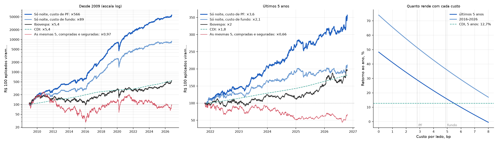
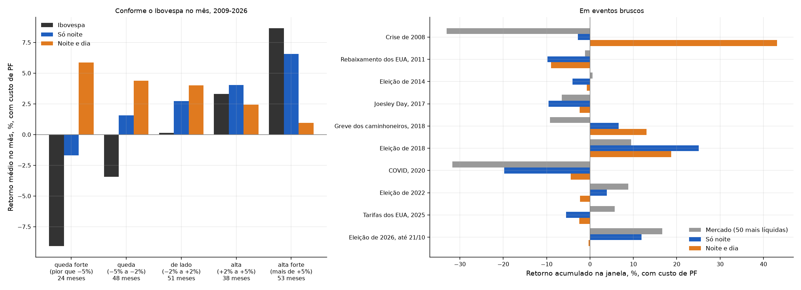
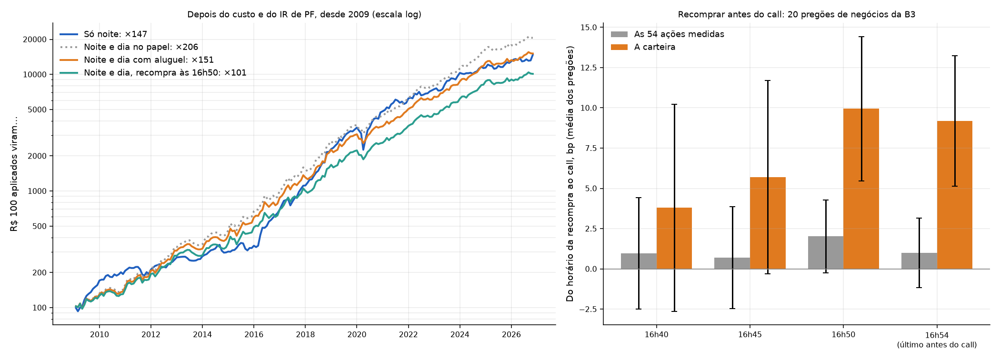

# overnight-intraday-br

Retornos overnight vs intraday na B3.

## Pergunta

Nos EUA e em vários mercados, quase todo o retorno das ações acontece entre o fechamento e a
abertura seguinte (overnight), enquanto o retorno durante o pregão (intraday) é nulo ou
negativo. É o padrão documentado por Knuteson, Cliff, Cooper & Gulen e Lou, Polk & Skouras, e
o do gráfico viral da Micron.

**Isso vale para as ações negociadas na B3?** E, se valer, sobrevive a custo, imposto e ao
CDI que o dinheiro renderia de noite?

## Resultado do passo 1

**Vale, e forte.** Carteira de peso igual das 100 ações mais líquidas, escolhidas a cada ano
só com dados do ano anterior (sem viés de sobrevivência), de 2000 a 2026:

- comprando no fechamento e vendendo na abertura, R$ 1 vira **R$ 1.428**;
- comprando na abertura e vendendo no fechamento, R$ 1 vira **R$ 0,03**.

O overnight ganha do intraday em 26 dos 27 anos. Ação por ação, a "Micron brasileira" é a
USIM5: **+153.866.610%** de noite e **−99,9996%** de dia, em 27 anos.

- Resultados completos: [`docs/resultados_passo1.md`](docs/resultados_passo1.md)
- Como os preços foram tratados, e por quê: [`docs/tratamento_dos_precos.md`](docs/tratamento_dos_precos.md)

## Comprar todas as líquidas toda noite? Não paga o custo

Backtest com as 30 ações mais líquidas de hoje, nos últimos 5 anos, executando nos leilões e
pagando custos reais (tarifa oficial de day trade da B3, corretagem e impacto):

| | Ibovespa | CDI | Overnight comprado, bruto | Overnight comprado, com custo |
|---|---|---|---|---|
| Retorno ao ano | 14,0% | 12,7% | 16,6% | **−8,9%** |
| Volatilidade ao ano | 18,3% | 0,1% | 9,9% | 9,9% |
| Sharpe (sobre o CDI) | 0,15 | — | 0,39 | −2,12 |
| Máximo drawdown | −21,0% | 0% | −10,4% | −45,7% |

Antes do custo, a estratégia bate o Ibovespa com metade do risco. Depois do custo, não: para
empatar com o CDI, o custo total teria de ser 0,77 bp por lado, e só a tarifa da B3 já é de 1,15
a 2,21 bp. Detalhes, métricas e onde o efeito ainda aparece: [`docs/backtest.md`](docs/backtest.md).

## Mas existe uma versão que faz dinheiro: a persistência

Busca com 315 configurações: ações, units, ETFs (índices), FIIs e BDRs, sete estratégias, nove
janelas e dois níveis de custo. Toda escolha usa só o passado. A versão que sobrevive é simples:
**todo mês, as 10 ações das 50 mais líquidas com a noite mais forte nos 12 meses anteriores;
compra no leilão de fechamento, vende no de abertura.**

| Últimos 5 anos | Ibovespa | CDI | Persistência, custo de mesa (2,9 bp) | Persistência, custo de fundo (4,9 bp) |
|---|---|---|---|---|
| Retorno ao ano | 14,0% | 12,7% | **27,1%** | 15,0% |
| Sharpe (sobre o CDI) | 0,15 | — | **0,95** | 0,22 |
| Máximo drawdown | −21,0% | 0% | −9,4% | −10,3% |

- Paga o custo de fundo em todos os subperíodos desde 2005.
- Com custo de mesa, ganha do CDI em 21 de 22 anos.
- No período longo, o Sharpe passa com folga do que 315 tentativas dariam por sorte.
- Para um fundo comum, fica no limite.

Os detalhes, o que não funcionou e a "Micron brasileira operável" (OIBR3: +771% só de noite,
com a ação caindo 99,8%) estão em [`docs/busca.md`](docs/busca.md).

## A carteira: 5 ações grandes, comprada de noite e vendida de dia

Todo mês, as 5 ações das 50 mais líquidas (preço acima de R$ 5, fora de recuperação judicial)
com a noite mais forte nos 12 meses anteriores. Metade do dinheiro compra no leilão de
fechamento e vende no de abertura. A outra metade vende no leilão de abertura e recompra no de
fechamento (day trade).

| Últimos 5 anos | Ibovespa | Carteira, custo de mesa | Carteira, custo de fundo | As mesmas 5, compradas e seguradas |
|---|---|---|---|---|
| Retorno ao ano | 14,0% | **34,8%** | **22,0%** | −4,6% |
| Volatilidade | 18,3% | **15,3%** | **15,3%** | 31,5% |
| Pior queda | −21% | −11% | −19% | −50% |

Atinge o objetivo na média de 5, 10 e 20 anos, mas **2025 e 2026 foram fracos**. Passo a
passo do trade, intuição, carteira atual e riscos: [`docs/carteira.md`](docs/carteira.md).

**Cenários:** a carteira ganha do Ibovespa em todos os meses de queda forte da bolsa e perde em
quase todos os de alta forte, porque a perna vendida apanha quando o pregão sobe. Metade carteira e
metade Ibovespa rendeu 25% ao ano nos últimos 5 anos (custo de mesa), com 10% de volatilidade.
As duas pernas das ações, a carteira contra o Ibovespa e os cenários: [`docs/cenarios.md`](docs/cenarios.md).

## Só de noite: a versão para operar como pessoa física

E se a gente só operar a noite? A carteira compra no leilão de fechamento, vende no de abertura
e nunca fica vendida. As 5 ações saem de um teste de 180 regras, com critério fixado antes de
rodar. Venceu a **média aparada da noite em 12 meses**: a média sem as 5% piores e as 5% melhores
noites, entre as 50 mais líquidas.

| Últimos 5 anos | Ibovespa | CDI | Só noite, custo de PF | Só noite, custo de fundo |
|---|---|---|---|---|
| Retorno ao ano | 14,4% | 12,7% | **29,0%** | 16,2% |
| Depois do IR de pessoa física | 12,7% | 11,1% | **20,6%** | — |
| Volatilidade | 18,3% | 0,1% | 14,7% | 14,7% |
| Pior queda | −21% | 0% | −11% | −13% |

- **Desde 2009:** 42,8% ao ano com custo de PF e Sharpe de 1,38. Isso passa com folga do que as
  510 tentativas do projeto dariam por sorte (0,84).
- **O risco é a noite de pânico:** na COVID, a carteira caiu 46% em cinco semanas.
- **Nas altas fortes, fica atrás do Ibovespa,** como em 2025 e 2026.
- **Corretora:** Rico, com seis perguntas para confirmar por escrito.

Custos, imposto, piso de preço, cenários, piores noites e a carteira de novembro estão em
[`docs/so_noite.md`](docs/so_noite.md).

## A decisão: o que vamos operar

**No papel,** a versão completa (comprada de noite e vendida de dia) é a melhor para pessoa
física, depois do custo e do imposto: 29,3% ao ano em 5 anos, contra 20,6% da só noite.

**No passo 8, a decisão prática foi a só noite.** O backtest da completa recompra o vendido no
call de fechamento, e as corretoras exigem fechar o day trade antes do call. **Nos passos 9 e 10, a
completa ficou viável** (seção seguinte). Ela cabe em lotes de 100 a partir de cerca de R$ 81 mil.

Também testei:
- **Eventos bruscos** (eleição, COVID, Joesley Day): três variantes da escolha das 5 para eles
  (alfa, sem eventos, teto de beta). Nenhuma passou no critério fixado antes.
- **O mercado de lado:** a completa vai melhor nele; a só noite vai melhor quanto mais a bolsa
  sobe.

Detalhes, corretora (Rico) e o plano da automação total: [`docs/decisao.md`](docs/decisao.md).

## A completa de verdade

As corretoras exigem zerar o day trade antes do call. Testei dois jeitos de contornar isso:
- **alugar as ações (BTC),** para a venda da manhã ser de ações que estão na custódia e tudo
  acontecer nos leilões. O aluguel das 5 de novembro custa 2,8% ao ano, mais a parte da B3 e da
  corretora;
- **recomprar o vendido antes do call,** no pregão contínuo. Nos negócios da B3, recomprar às
  16h40 em vez de no call não perdeu nada em média. O custo é o meio spread.

| Custo de PF | Depois do IR, últimos 5 anos | Sharpe depois do IR, pior subperíodo | Queda máxima desde 2009 |
|---|---|---|---|
| Noite e dia com aluguel | 27,0% | 1,07 | −16% |
| **Noite e dia, recompra antes do call (a que vamos operar)** | **25,2%** | **0,96** | −16% |
| Só noite | 20,6% | 0,15 | −35% |

**A pesquisa das corretoras tirou o aluguel:**
- na Rico, ele é automático, e a conta Posição do MT5 é sem alavancagem;
- na Genial, as ordens com ações alugadas pagariam corretagem de swing.

A versão operada é a recompra antes do call, com a perna da noite na Rico e a do dia na Genial
(seção seguinte).

Também medi, nos negócios intradiários da B3, quanto custa recomprar antes do call (só o meio
spread) e testei a mesma regra fora do Brasil. **Nos EUA, a só noite nas ações grandes funciona**
(19,5% ao ano em dólar depois do IR, com 1 bp por lado), mas fica atrás da completa brasileira.
ADRs, ETFs, mini-índice, CFD e opções não servem. Detalhes: [`docs/execucao.md`](docs/execucao.md).

## Automação: Rico de noite, Genial de dia

Nenhuma corretora faz as duas pernas num MetaTrader 5 só. Então:
- **Rico, MT5 "conta Posição":** a perna da noite, com corretagem zero em swing e day trade;
- **Genial, MT5 de day trade:** a perna do dia, com corretagem zero em day trade e RLP. Recompra
  às 16h30, antes da zeragem automática das 16h40.

O executor ([`executor.py`](src/overnight_br/executor.py)) manda as ordens dos leilões sozinho:
- conversa com cada terminal pelo pacote oficial `MetaTrader5`;
- avisa no celular pelo ntfy;
- tem travas: modo simulado por padrão, teto por ordem, uma vez por etapa e arquivo `PARAR`.

Decisão, fontes, passo a passo e fases: [`docs/automacao.md`](docs/automacao.md).

## E com opções?

Testei a estratégia e as anteriores com calls e puts. Foram 16 estratégias, com as opções do
próprio COTAHIST de 2009 a 2026 e 0, meio e 1 tick de custo por lado. **Nenhuma ganhou das
ações.** O tick de R$ 0,01 é caro numa opção de R$ 0,65, e a opção perde valor de noite. A melhor,
ações de noite com puts de dia, teria Sharpe de 1,84 sem custo, mas cai para 0,90 com meio tick.
A versão em ações tem 1,35. Detalhes: [`docs/opcoes.md`](docs/opcoes.md).

## Como operar de verdade

O manual completo está em [`docs/como_operar.md`](docs/como_operar.md): teoria, rotina
minuto a minuto, como mandar ordens nos leilões, checklist de corretora, imposto de pessoa
física, plano em fases e regras para parar. As ferramentas ficam em
[`src/overnight_br/operacao.py`](src/overnight_br/operacao.py), e o agendamento no Windows em
[`scripts/agendar_windows.ps1`](scripts/agendar_windows.ps1). Elas atualizam os dados, escolhem
a carteira do mês, montam a boleta de cada leilão, rodam o teste em papel e conferem as
execuções. O envio das ordens fica com você até um executor ser escrito e testado para a sua
corretora.

## A conta

Para cada ação e pregão, com os preços crus do COTAHIST divididos pela unidade de cotação:

    r_intraday  = fechamento_t / abertura_t − 1        (mesma linha do arquivo, sem ajuste)
    r_overnight = abertura_t / fechamento_{t−1} − 1    (só nas noites sem evento corporativo)

A noite que termina na data-ex de um dividendo, desdobramento ou grupamento fica de fora:
1,17% das noites. Essa noite é identificada pelo campo DISMES do COTAHIST, que muda exatamente
na data-ex. O motivo está em [`docs/tratamento_dos_precos.md`](docs/tratamento_dos_precos.md).

## Estado

| Fase | Situação |
|---|---|
| 1. Revisão de literatura | Concluída: [`docs/literature_review.md`](docs/literature_review.md). Conclusão: **testado só parcialmente no Brasil** |
| 1b. O caso Micron (Knuteson, ex-D. E. Shaw) | Pesquisado: [`docs/knuteson_micron.md`](docs/knuteson_micron.md) |
| Passo 1. Overnight vs intraday, 100 mais líquidas | **Concluído**: [`docs/resultados_passo1.md`](docs/resultados_passo1.md) |
| Passo 2. Backtest de um fundo, com custos reais | **Concluído**: [`docs/backtest.md`](docs/backtest.md) |
| Passo 3. Busca por uma versão que pague o custo | **Concluído**: [`docs/busca.md`](docs/busca.md) |
| Passo 4. A carteira de 5 ações | **Concluído**: [`docs/carteira.md`](docs/carteira.md) |
| Passo 5. Pernas, carteira contra o Ibovespa e cenários | **Concluído**: [`docs/cenarios.md`](docs/cenarios.md) |
| Passo 6. Operação: manual, boleta, papel e agendamento | **Concluído**: [`docs/como_operar.md`](docs/como_operar.md) |
| Passo 7. Só noite: como escolher as 5, bateria completa e corretora | **Concluído**: [`docs/so_noite.md`](docs/so_noite.md) |
| Passo 8. Decisão: qual estratégia operar, mercado de lado e eventos bruscos | **Concluído**: [`docs/decisao.md`](docs/decisao.md) |
| Passo 9. Execução: a completa com aluguel, a recompra antes do call e os mercados de fora | **Concluído**: [`docs/execucao.md`](docs/execucao.md) |
| Passo 10. Automação: corretoras (Rico + Genial) e o executor | **Em andamento**: código pronto e testado no simulado; falta abrir as contas ([`docs/automacao.md`](docs/automacao.md)) |
| Passo 11. As estratégias com opções de compra e de venda | **Concluído**: nenhuma ganha das ações ([`docs/opcoes.md`](docs/opcoes.md)) |

## Dados

O passo 1 usa **só o COTAHIST da B3** (gratuito): abertura, fechamento, volume, unidade de
cotação e número de distribuição de todo papel que negociou desde 1995, inclusive os que saíram
da bolsa. Nenhuma fonte de eventos ou preço ajustado entra na conta. Yahoo e o gabarito de
eventos do quantbr serviram só para validar (ver o tratamento dos preços, item 9).

O backtest usa também o CDI do Banco Central (SGS, série 12) e a tabela oficial de tarifas da
B3, transcrita no código.

O passo 9 usa ainda dados públicos que o COTAHIST não tem: o negócio a negócio e as taxas de
aluguel da B3 (só os últimos ~21 pregões ficam no ar, então o resumo é guardado em `results/`), e,
para os mercados de fora, o Yahoo Finance, a composição histórica do S&P 500
([fja05680/sp500](https://github.com/fja05680/sp500)) e o T-bill do FRED.

## Como reproduzir

Requer [uv](https://docs.astral.sh/uv/). Python 3.12, fixado em `.python-version`.

    uv sync
    uv run python -m overnight_br.pipeline   # baixa ~700 MB da B3 na primeira vez
    uv run python -m overnight_br.backtest   # baixa o CDI do Banco Central
    uv run python -m overnight_br.busca      # as 315 tentativas (~2 min)
    uv run python -m overnight_br.carteira   # a carteira de 5 ações e a lista de hoje
    uv run python -m overnight_br.analise_carteira   # gráficos e cenários da carteira
    uv run python -m overnight_br.selecao            # as 180 regras de escolha das 5 (~5 min)
    uv run python -m overnight_br.so_noite           # a bateria da só noite (~10 min)
    uv run python -m overnight_br.decisao            # a decisão: versões, lateral, eventos (~4 min)
    uv run python -m overnight_br.imposto_pf         # efeito do imposto de pessoa física
    uv run python -m overnight_br.b3_publico         # negócio a negócio e aluguel recentes da B3
    uv run python -m overnight_br.execucao           # como executar a completa (~2 min)
    uv run python -m overnight_br.exterior           # EUA, ADRs e ETFs (~15 min na 1ª vez)
    uv run python -m overnight_br.executor --help    # o executor dos leilões (MetaTrader 5)
    uv run python -m overnight_br.opcoes             # as estratégias com opções (~20 min)
    uv run python -m overnight_br.operacao --help    # operação: escolha, boleta, papel, conferir
    uv run pytest

Os dois gravam em `results/` as figuras e as tabelas em CSV.

## Estrutura

    src/overnight_br/
      cotahist.py      baixa e lê o COTAHIST (mercado à vista)
      painel.py        as duas pernas de cada ação em cada pregão, e as noites excluídas
      universo.py      as 100 mais líquidas de cada ano, só com dados do ano anterior
      resultados.py    carteira, tabela por ação e figuras
      pipeline.py      tudo de ponta a ponta
      backtest.py      o fundo: estratégias, custos da B3, métricas contra Ibovespa e CDI
      busca.py         a busca: classes de ativo, estratégias, janelas e o registro de tentativas
      carteira.py      a carteira de 5 ações: regra, as duas pernas e a lista de hoje
      analise_carteira.py  gráficos das pernas, contra o Ibovespa, e os cenários
      selecao.py       como escolher as 5: as 180 regras, o critério e a regra escolhida
      so_noite.py      a só noite: métricas, custo, piso, imposto, cenários e piores noites
      decisao.py       qual versão operar, mercado de lado e eventos bruscos
      imposto_pf.py    o imposto de pessoa física, mês a mês
      b3_publico.py    negócio a negócio e taxas de aluguel recentes da B3
      execucao.py      como executar a completa: aluguel, recompra antes do call, filtro
      exterior.py      a mesma regra nos EUA, nos ADRs brasileiros e em ETFs
      corretora.py     a conversa com a corretora: simulada ou MetaTrader 5
      executor.py      manda as ordens dos leilões nas duas contas, com travas
      alertas.py       registro e avisos no celular (ntfy)
      opcoes.py        as estratégias com calls e puts, das opções do COTAHIST
      operacao.py      operar: escolha do mês, boleta dos leilões, papel e conferência
    scripts/           agendamento da rotina no Windows
    data/              bruto e processado; fora do git, o pipeline refaz
    results/           tabelas e figuras
    docs/              literatura, tratamento dos preços, resultados
    tests/

## Créditos

O layout do COTAHIST e várias armadilhas de dados vêm do projeto quantbr, do mesmo autor. O
código é portado e adaptado, e o cabeçalho de cada módulo indica a origem.
