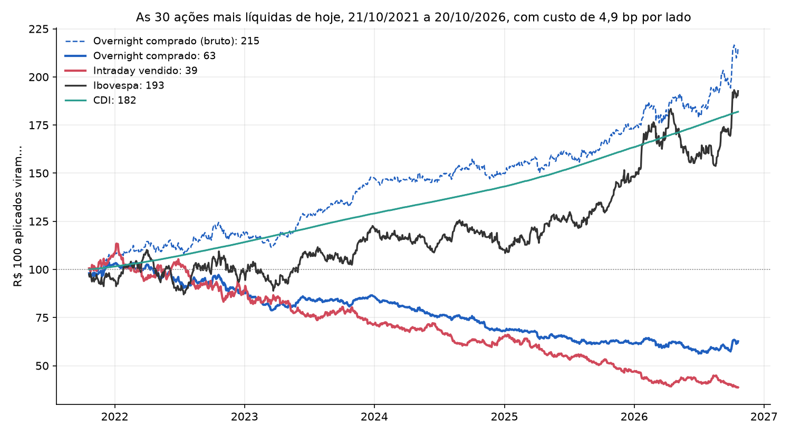

# Backtest: um fundo consegue ganhar dinheiro com isso?

Gerado por `uv run python -m overnight_br.backtest` (depois do pipeline), com dados até
20/10/2026. Código: [`src/overnight_br/backtest.py`](../src/overnight_br/backtest.py).

**Resposta curta: não.** Nas ações líquidas o efeito ainda existe, e antes do custo a
estratégia overnight bate o Ibovespa com metade da volatilidade. Mas o que ela rende acima do CDI
(1,5 bp por noite) é menor que a tarifa que a B3 cobra para entrar e sair todo dia. Nenhum
tamanho de fundo resolve isso.

## 1. O desenho

- **Ações:** as 30 mais líquidas de hoje, por volume mediano diário nos últimos 252 pregões:
  PETR4, VALE3, ITUB4, BBDC4, B3SA3, AXIA3, BBAS3, BPAC11, PETR3, PRIO3, SBSP3, EMBJ3, ABEV3,
  WEGE3, ITSA4, RENT3, EQTL3, SUZB3, VBBR3, CPLE3, RDOR3, ENEV3, GGBR4, RADL3, LREN3, BBSE3,
  CSMG3, UGPA3, RAIL3, VIVT3. AXIA3, EMBJ3 e VBBR3 trocaram de ticker no período. O histórico
  vem de ELET3, EMBR3 e BRDT3 (conferido: pregões consecutivos e preço contínuo na troca).
- **Período:** os últimos 5 anos, de 21/10/2021 a 20/10/2026 (1.247 pregões).
- **Fundo de referência:** R$ 10 milhões, com peso igual entre as ações.
- **Execução:** sempre nos leilões de abertura e de fechamento. O preço do COTAHIST é o desses
  leilões.

| Estratégia | O que faz | Onde fica o dinheiro |
|---|---|---|
| **Overnight comprado** | compra no leilão de fechamento, vende no de abertura do dia seguinte | nas ações, sem render CDI (a liquidação em D+2 casa a venda da manhã com a compra da tarde) |
| **Intraday vendido** | vende no leilão de abertura, recompra no de fechamento (day trade, sem aluguel) | em título público, como garantia: rende CDI |
| Ibovespa | compra e segura o BOVA11, o ETF do índice | — |
| CDI | renda fixa | — |

O fundo não carrega a ação na noite da data-ex. A data é conhecida com antecedência, e isso
evita misturar dividendo com retorno da estratégia.

## 2. Custos reais

| Item | Por lado | Fonte |
|---|---|---|
| Tarifa da B3 (negociação + CCP) | **1,94 bp** | Tabela oficial, versão 3.0, em vigor desde 15/08/2025 (Ofício Circular 097/2025-PRE). Faixa de day trade de R$ 10 a 30 mi por dia: o fundo gira R$ 20 mi por dia |
| Corretagem | 1,0 bp | premissa (institucional, negociada) |
| Impacto no leilão | 2,0 bp | premissa |
| **Total** | **4,9 bp** | ida e volta todo dia: 9,9 bp por dia, **cerca de 25% ao ano** |

**Por que é day trade para a B3.** Na mesma conta e no mesmo dia, a mesma ação é vendida num
leilão e comprada no outro. A regra de casamento da B3 (item 1.4.1 da tabela) junta as duas
pontas como day trade. O desconto de leilão (0,007% de negociação) vale só para operação que
não é day trade, então não se aplica.

A tarifa da B3 cai com o tamanho do fundo, mas tem piso:

| Patrimônio do fundo | R$ 1 mi | R$ 10 mi | R$ 50 mi | R$ 100 mi | R$ 500 mi | R$ 1 bi | sem limite |
|---|---|---|---|---|---|---|---|
| Tarifa B3 por lado | 2,21 bp | 1,94 bp | 1,79 bp | 1,69 bp | 1,36 bp | 1,26 bp | 1,15 bp |

**Imposto:** fundo de ações não paga imposto por operação (o cotista paga no resgate). Uma
pessoa física pagaria ainda 20% de IR de day trade.

## 3. Resultado

| | CDI | Ibovespa | Overnight comprado, bruto | **Overnight comprado** | **Intraday vendido** |
|---|---|---|---|---|---|
| Retorno em 5 anos | +81,9% | +92,7% | +115,1% | **−37,3%** | **−61,2%** |
| Retorno ao ano | 12,7% | 14,0% | 16,6% | **−8,9%** | **−17,3%** |
| Volatilidade ao ano | 0,1% | 18,3% | 9,9% | 9,9% | 14,8% |
| Sharpe (sobre o CDI) | — | 0,15 | 0,39 | −2,12 | −2,03 |
| Máximo drawdown | 0% | −21,0% | −10,4% | −45,7% | −65,8% |
| Information ratio (sobre o Ibovespa) | −0,15 | — | 0,07 | −1,58 | −1,06 |
| Tracking error ao ano | 18,3% | — | 15,1% | 15,1% | 31,2% |
| Beta com o Ibovespa | 0,00 | 1,00 | 0,31 | 0,31 | −0,62 |
| Correlação com o Ibovespa | 0,01 | 1,00 | 0,57 | 0,57 | −0,77 |

As colunas em negrito já têm o custo de 4,9 bp por lado. A tabela completa, inclusive o
intraday vendido bruto, está em
[`results/backtest_metricas.csv`](../results/backtest_metricas.csv).

**O que o bruto mostra.** Antes do custo, o overnight comprado é um produto atraente: rende
mais que o Ibovespa (16,6% contra 14,0% ao ano), com metade da volatilidade (9,9% contra
18,3%), metade do drawdown (−10% contra −21%) e beta de 0,31. A anomalia existe nas
líquidas.

**O que o custo faz.** Rodar o patrimônio duas vezes por dia custa cerca de 25% ao ano. O
overnight comprado vai de +16,6% para −8,9% ao ano.

**Quanto custo a estratégia aguenta.** É o número que decide, porque não depende das
premissas de corretagem e impacto:

| Custo por lado que deixa a estratégia empatada com… | CDI (Sharpe zero) | Ibovespa |
|---|---|---|
| Overnight comprado | **0,77 bp** | 0,21 bp |
| Intraday vendido | perde mesmo com custo zero | perde mesmo com custo zero |

Em média, o overnight bruto rende 6,3 bp por noite e o CDI 4,8 bp por dia. Sobram 1,5 bp por
noite, ou 0,77 bp por lado. **Só a tarifa da B3 é de 1,15 a 2,21 bp por lado.** Mesmo com
corretagem e impacto zero, e mesmo para um fundo de tamanho infinito, a estratégia perde para o
CDI.

## 4. Onde o efeito continua funcionando

**No tempo.** Nas mesmas 30 ações, média por noite e por pregão, em bp. Até 2020 entram só as
que já negociavam.

| | 2016 | 2017 | 2018 | 2019 | 2020 | 2021 | 2022 | 2023 | 2024 | 2025 | 2026 |
|---|---|---|---|---|---|---|---|---|---|---|---|
| Overnight | 17,2 | 12,1 | 15,5 | 12,5 | 13,1 | 9,1 | 4,3 | 8,7 | 0,7 | 5,9 | 11,2 |
| Intraday | 4,8 | 1,9 | −4,4 | 5,9 | −4,1 | −8,8 | 2,2 | 3,2 | −2,5 | 8,2 | 4,5 |

- O overnight é positivo em todos os anos, mas encolheu: de 12 a 17 bp por noite até 2020 para
  0,7 a 11 bp depois.
- **Nas líquidas, o intraday não é negativo**: foi positivo em 7 dos 11 anos. O pregão fraco
  do passo 1 vinha das ações menos líquidas.
- Ano a ano, com custo, o overnight comprado só fica positivo em 2021 (+2,9%, de outubro a
  dezembro) e em 2026 (+1,9%, até outubro). Ver
  [`results/backtest_por_ano.csv`](../results/backtest_por_ano.csv).

**Por ação** (ver [`results/backtest_por_acao.csv`](../results/backtest_por_acao.csv)):

- O overnight bruto é positivo em 28 das 30 ações, mas só 6 cobrem o custo.
- Só a EMBJ3 (Embraer, +16,9 bp por noite, +17,5% ao ano líquido) rende mais que o CDI.
  Escolher a Embraer olhando para trás é fácil; difícil seria escolher em 2021.
- O intraday é positivo em 20 das 30 ações. O intraday vendido perde dinheiro em todas, depois
  do custo.

| Ação | Overnight por noite | Intraday por pregão | Overnight comprado, líquido, ao ano |
|---|---|---|---|
| EMBJ3 | +16,9 bp | −3,2 bp | +17,5% |
| PRIO3 | +14,9 bp | −3,8 bp | +10,7% |
| SUZB3 | +11,7 bp | −10,0 bp | +3,7% |
| LREN3 | +11,0 bp | −11,4 bp | +1,0% |
| PETR4 | +10,9 bp | +7,0 bp | +1,1% |
| VALE3 | +10,8 bp | −6,4 bp | +0,6% |
| … | | | |
| RADL3 | −0,3 bp | +2,8 bp | −23,3% |
| RDOR3 | −3,1 bp | +4,8 bp | −28,9% |

## 5. Ressalvas

1. **A lista de hoje olha para trás.** Escolher as líquidas de hoje usa informação que o fundo
   não tinha em 2021. Para checar, refizemos com as 30 mais líquidas de cada ano, escolhidas só
   com o ano anterior. O overnight bruto fica **mais forte** (9,0 bp por noite, +24,4% ao ano,
   Sharpe 0,91), porque entram ações que depois perderam liquidez, e nelas o efeito é maior.
   Mesmo assim, fica abaixo do custo de ida e volta (9,9 bp por dia), e a conclusão não muda.
2. **Impacto e capacidade.** O COTAHIST não traz o volume dos leilões, então os 2 bp de impacto
   são premissa. Isso também não muda a conclusão: o custo de equilíbrio (0,77 bp) fica abaixo
   até da tarifa da B3 sozinha.
3. **Benchmark.** Usamos o BOVA11 porque está no próprio COTAHIST e é o que um fundo compraria.
   Ele acompanha o índice: correlação diária de 0,98 com o Ibovespa do Yahoo (^BVSP) nos mesmos
   1.247 pregões. No período, o ETF subiu 92,7% e o índice 88,0% (de 110.786 para 208.296
   pontos). Como o ETF ganhou do índice, o comparativo fica um pouco mais difícil de bater.
4. **O que poderia mudar o resultado:** um instrumento com custo muito menor por operação,
   como o futuro de Ibovespa. Não há histórico gratuito dele, e o horário do futuro é outro, então
   a noite dele não é a mesma das ações. Fica como pergunta em aberto.
