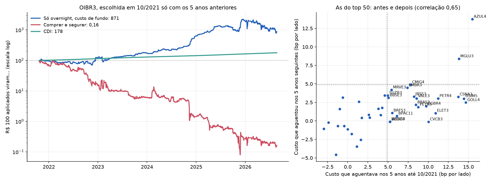

# A busca: dá para fazer a anomalia virar dinheiro?

Gerado por `uv run python -m overnight_br.busca` (depois do pipeline), com dados até
20/10/2026. Código: [`src/overnight_br/busca.py`](../src/overnight_br/busca.py). Todas as
315 configurações testadas estão em
[`results/busca_tentativas.csv`](../results/busca_tentativas.csv).

**Resposta curta: dá, para quem opera barato.**

- **A versão que funciona:** todo mês, pegar as 10 ações (20%) das 50 mais líquidas com a
  noite mais forte nos 12 meses anteriores. Comprar no leilão de fechamento e vender no de
  abertura, todo dia.
  - Últimos 5 anos, com custo de mesa (2,9 bp por lado): **27% ao ano**, contra 12,7% do CDI e
    14,0% do Ibovespa. Sharpe 0,95, drawdown −9%.
  - Ganha do CDI em **21 dos 22 anos** desde 2005.
- **Para um fundo comum** (4,9 bp por lado), fica no limite: 15% ao ano nos últimos 5 anos,
  Sharpe 0,22.
- **"Uma ação":** a regra "a melhor dos 5 anos anteriores" escolheu a OIBR3 em outubro de 2021.
  Só no overnight, com custo de fundo, ela rendeu **+771%** enquanto a ação perdia **99,8%**.
  Mas com drawdown de −65% e preço de centavos (ver item 5).

## 1. Custos possíveis

| Quem opera | Tarifa B3 | Corretagem | Impacto no leilão | Total por lado |
|---|---|---|---|---|
| Fundo de R$ 10 mi | 1,9 bp (day trade) | 1 bp | 2 bp | **4,9 bp** |
| Mesa proprietária | 1,9 bp (day trade) | 0 | 1 bp | **2,9 bp** |
| Mesa no Programa HFT da B3 | 1,1 a 1,2 bp | 0 | 1 bp | ~2,2 bp |

O Programa HFT da B3 (em vigor desde 01/09/2025) cobra 0,011% a 0,012% por lado nos leilões,
mas tem condições:
- vale só para ações de liquidez média (volume de R$ 100 a 500 mi por dia);
- exige do investidor pelo menos R$ 25 a 30 mi por dia nesse grupo e 85% de day trade.

Corretagem e impacto são premissas. Por isso a tabela principal mostra o **custo de
equilíbrio**: o custo por lado que ainda empata com o CDI. Ele independe das premissas.

## 2. O que foi testado: 315 configurações

- **Ativos:**
  - ações: as 100 mais líquidas de cada ano (units incluídas) e as 50 mais líquidas;
  - ETFs: os 10 mais líquidos (BOVA11, SMAL11, IVVB11...), que são os índices negociáveis;
  - FIIs: os 30 mais líquidos;
  - BDRs: os 30 mais líquidos.
- **Estratégias:** sete. Em todas, a escolha usa só o passado.

  | Estratégia | O que faz |
  |---|---|
  | todas | compra todo o universo de noite |
  | persistência | os 20% com a noite mais forte nos 12 meses anteriores |
  | queda | os 10% que mais caíram no pregão do dia |
  | queda pelo preço médio | o mesmo, medindo a queda até o preço médio do dia |
  | persistência + queda | entre os 20% da persistência, a metade que mais caiu no dia |
  | persistência + queda pelo preço médio | o mesmo, com a queda até o preço médio |
  | intraday vendido | vende no pregão os 20% com o pior intraday dos 12 meses anteriores |

- **Janelas:** nove.
  - Quatro sem sobreposição: 2005–2010, 2011–2015, 2016–2020 e 2021–2026.
  - Cinco recortes: 2005–2026, 2016–2026, 5 anos, 3 anos e 12 meses.

## 3. O que não funciona

Custo de equilíbrio nos últimos 5 anos, em bp por lado. Lembrando: mesa = 2,9, fundo = 4,9.

| | Ações (100) | Ações (50) | ETFs | FIIs | BDRs |
|---|---|---|---|---|---|
| todas | 1,7 | 1,8 | 1,1 | 1,0 | 6,4 |
| persistência | 4,5 | **5,5** | 4,5 | 3,2 | 8,3 |
| queda pelo preço médio | 3,0 | 2,9 | 2,8 | 2,7 | 11,7 |
| persistência + queda pelo preço médio | 4,2 | **6,0** | 4,1 | 3,7 | 10,3 |
| intraday vendido | 6,8 | 9,1 | 4,1 | 4,0 | 3,8 |
| *liquidez das escolhidas (R$ mi/dia)* | *~90* | *~200* | *~15* | *~4* | *~0,3* |

- **Comprar tudo, inclusive o índice (ETF), não paga.**
- **BDRs** parecem ótimos, mas as escolhidas negociam R$ 0,3 mi por dia. É preço parado de
  papel ilíquido, não oportunidade.
- **FIIs** não pagam o custo de fundo e negociam pouco.
- **A versão "queda" pelo preço de fechamento estava inflada.** Ela escolhia pela queda medida
  no próprio leilão de fechamento e comprava nesse preço, algo que não se sabe a tempo.
  Medindo a queda até o preço médio do dia, o ganho cai à metade (ações top 100, 5 anos: de 4,5
  para 3,0 bp). Por isso as versões pelo fechamento ficam fora das conclusões.
- **O intraday vendido** funcionou nas 50 mais líquidas em 5 anos (9,1 bp), mas fraquejou nos
  últimos 12 meses (1,4 bp) e tem drawdown de −29%.

## 4. O que funciona: persistência nas 50 mais líquidas

**A regra:**
- **Universo:** no começo de cada ano, as 50 ações de maior volume mediano no ano anterior.
- **Escolha:** no começo de cada mês, as 20% (cerca de 10) com o maior overnight médio nos 12
  meses anteriores. Mínimo de 120 noites.
- **Operação:** todo dia, compra no leilão de fechamento e vende no de abertura. Pula a noite da
  data-ex.

| Período | Custo que aguenta | Mesa: ao ano | Sharpe | Drawdown | Fundo: ao ano | Sharpe | CDI |
|---|---|---|---|---|---|---|---|
| 2005–2010 | 7,7 bp | 40,9% | 1,35 | −19% | 27,6% | 0,79 | 13,0% |
| 2011–2015 | 5,9 bp | 26,4% | 0,88 | −17% | 14,4% | 0,30 | 10,4% |
| 2016–2020 | 13,1 bp | 71,6% | 1,86 | −40% | 55,5% | 1,50 | 7,8% |
| 2021–2026 | 5,8 bp | 27,5% | 1,05 | −9% | 15,4% | 0,32 | 11,4% |
| **Últimos 5 anos** | **5,5 bp** | **27,1%** | **0,95** | **−9%** | **15,0%** | **0,22** | 12,7% |
| Últimos 12 meses | 4,9 bp | 24,8% | 0,67 | −8% | 13,0% | −0,01 | 14,4% |

**Por que acreditar:**
- **Persistência é a anomalia mais documentada do tema** (Lou, Polk e Skouras, 2019). Aqui ela é
  monótona: separando as 100 mais líquidas em cinco grupos pela noite dos 12 meses anteriores, o
  grupo mais forte ganha do mais fraco no mês seguinte em 97% dos meses desde 2005.
- **Paga o custo de fundo em todos os quatro subperíodos sem sobreposição**, e o de mesa com
  folga.
- **Ganha do CDI ano a ano:** com custo de mesa, em 21 dos 22 anos (só perde em 2011, por
  1,6 ponto). Com custo de fundo, em 15 dos 22.
- **Não depende de poucos dias:** tirando os 10 maiores dias dos últimos 5 anos, o resultado
  até melhora (de ×3,31 para ×3,53).
- **É líquida:** as escolhidas negociam em mediana R$ 220 mi por dia. As que mais apareceram nos
  últimos 5 anos foram PRIO3 (50 de 61 meses), MGLU3, AZUL4, EMBR3, RRRP3, CMIG4, GGBR4, MRVE3,
  VALE3 e LREN3.

**O teste de sorte.** Com 315 tentativas, o maior Sharpe que apareceria só por acaso é cerca de
√(2 ln 315)/√anos:

| Janela | Sharpe da estratégia (mesa) | Maior Sharpe esperado por sorte |
|---|---|---|
| 2005–2026 | 1,32 | 0,73 |
| 2016–2026 | 1,48 | 1,03 |
| 5 anos | 0,95 | 1,52 |

- **No período longo, não é sorte.**
- **Os últimos 5 anos isolados são curtos demais para provar sozinhos.** O que sustenta é a
  regra ter funcionado em todos os subperíodos sem ter sido escolhida para eles.

**Uma melhoria possível:** dentro das 10 da persistência, comprar só as 5 que mais caíram até o
preço médio do dia. Nos últimos 5 anos, com custo de mesa, dá 30,1% ao ano (Sharpe 1,03); com
custo de fundo, 17,7%. O ganho sobre a regra simples é pequeno, e ela usa informação do próprio
dia.

## 5. "Se acharmos uma ação"

**Fora da amostra.** Regra fixada antes: em outubro de 2021, escolher a ação das 50 mais
líquidas com o maior custo de equilíbrio nos 5 anos anteriores. Ela escolheu a **OIBR3**, e de
lá até 20/10/2026:

| | Comprar e segurar | Só overnight, custo de fundo | CDI |
|---|---|---|---|
| Retorno no período | **−99,8%** | **+771%** | +78% |
| Drawdown máximo | −99,9% | −65% | 0% |
| Volatilidade ao ano | 127% | 55% | — |

**Mas não recomendo apostar nela.** A Oi passou quase todo o período valendo menos de R$ 2, e
chegou a R$ 0,05. Abaixo de R$ 2, um único tick (R$ 0,01) vale mais de 50 bp; a R$ 0,30, vale
333 bp. O "overnight médio"
de 20 a 60 bp é, na prática, a frequência com que a ação abre um tick acima. Isso existe nos
preços do leilão, mas o risco é enorme e a capacidade, mínima.

**Olhando para trás (com o viés de saber o futuro).** O gráfico da direita compara, ação por
ação, o custo de equilíbrio nos 5 anos até 2021 com o dos 5 anos seguintes, entre as que
ficaram no top 50 nos dois períodos.
- A correlação é de 0,65: quem tinha noite forte continuou tendo. É a base da persistência.
- **AZUL4 e MGLU3 pagaram o custo de fundo nos dois períodos.** A AZUL4, só no overnight, rendeu
  +760% de outubro de 2021 a dezembro de 2025, enquanto a ação caía 97% até o Chapter 11.
- Exigir que a ação continue no top 50 é olhar para o futuro, então isso não é estratégia. É a
  ilustração de onde o efeito mora: **ações de varejo em queda longa**, em que o preço sobe de
  noite e cai de dia.

## 6. Ressalvas

1. **Capacidade.** O COTAHIST não traz o volume dos leilões de abertura, então o impacto é
   premissa. A regra opera cerca de 10 ações com R$ 220 mi por dia de mediana. Para uma mesa
   pequena, de poucos milhões, parece viável. Para um fundo grande, não sei.
2. **Risco de cauda.** A estratégia fica comprada toda noite e leva o gap de notícia:
   - caiu 40% entre 12/02 e 19/03/2020, na COVID;
   - perdeu 20,3% numa noite só, no Joesley Day (18/05/2017).
3. **Operação.** Duas ordens por ação por dia, sempre nos leilões, pulando datas-ex. É simples,
   mas precisa de execução disciplinada.
4. **Imposto.** Fundo de ações não paga imposto por operação. Pessoa física pagaria 20% sobre o
   resultado de day trade, e aqui o casamento de day trade torna a conta pouco intuitiva.
5. **Contagem de tentativas.** As 315 configurações estão em `results/busca_tentativas.csv`, com
   o "Sharpe por sorte" de cada janela. Sondagens exploratórias antes da busca (reversão e
   persistência por grupos) não estão nesse número.
