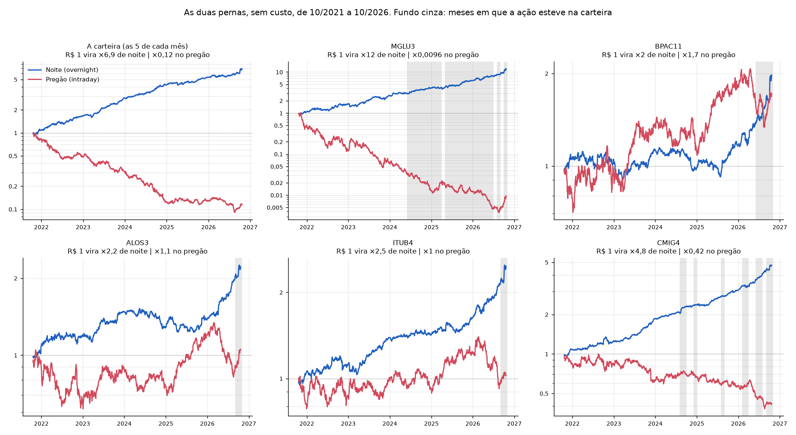
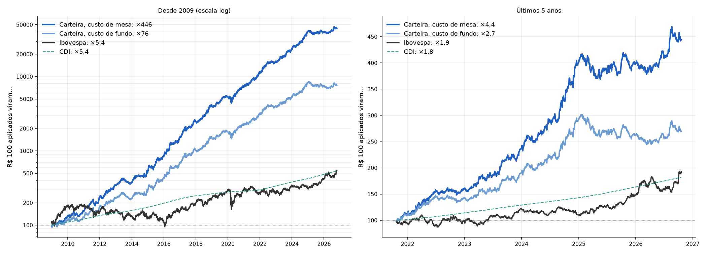
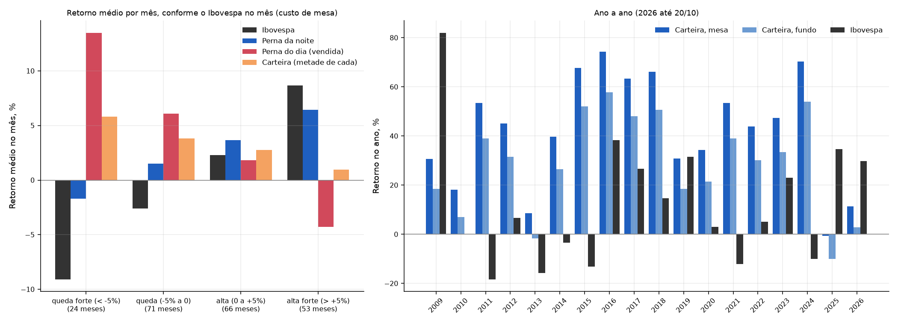

# A carteira por dentro: as duas pernas, contra o Ibovespa e os cenários

Gerado por `uv run python -m overnight_br.analise_carteira` (depois do pipeline), com dados até
20/10/2026. A regra da carteira está em [`carteira.md`](carteira.md). Código:
[`src/overnight_br/analise_carteira.py`](../src/overnight_br/analise_carteira.py).

> Isto é resultado de pesquisa com dados históricos, não recomendação de investimento.

## Resumo

| A carteira vai **bem** quando… | A carteira vai **mal** quando… |
|---|---|
| a bolsa cai no mês: ganha do Ibovespa em 100% dos meses de queda forte | a bolsa sobe forte durante o pregão: só ganha do Ibovespa em 9% dos meses de alta forte |
| há gaps de alta na abertura (eleição de 2018) | há choque de noite, com gap de baixa na abertura (Joesley Day, agosto de 2011) |
| — indiferente: mercado calmo ou nervoso, juros altos ou baixos | — não dá para antecipar os meses ruins com os sinais testados |

**A forma mais simples de conviver com isso:** metade na carteira e metade no Ibovespa. Nos
últimos 5 anos, essa combinação rendeu 25% ao ano com custo de mesa e 19% com custo de fundo,
com volatilidade de 10% (contra 18% do Ibovespa) e pior queda de −7%.

## 1. As duas pernas das ações da carteira

Noite e pregão acumulados, sem custo, nos últimos 5 anos. O fundo cinza marca os meses em que a
ação esteve na carteira.

- **A carteira (as 5 de cada mês):** R$ 1 vira ×6,9 de noite e ×0,12 no pregão. É a mesma
  "Micron" do começo do projeto, agora com ações grandes.
- **MGLU3 e CMIG4 têm o padrão clássico** (noite subindo, pregão caindo) há 5 anos e passaram
  vários meses na carteira.
- **BPAC11, ALOS3 e ITUB4 entraram só agora, em 2026.** A noite delas disparou na alta deste
  ano, mas em 5 anos o pregão delas não é negativo. Elas foram escolhidas mais pela alta da bolsa
  do que por uma clientela antiga. Por isso a perna vendida pode render pouco nelas.

## 2. A carteira contra o Ibovespa

| R$ 100 aplicados viram… | Desde jan/2009 | Últimos 5 anos |
|---|---|---|
| Carteira, custo de mesa | R$ 44.600 | R$ 444 |
| Carteira, custo de fundo | R$ 7.600 | R$ 270 |
| Ibovespa (BOVA11) | R$ 540 | R$ 193 |
| CDI | R$ 540 | R$ 182 |

## 3. Os cenários, mês a mês desde 2009 (214 meses, custo de mesa)

### 3.1 O que a bolsa faz no mês: o que mais importa

| Ibovespa no mês | Meses | Carteira | Carteira, custo de fundo | Perna da noite | Perna do dia | Ibovespa | Meses acima do Ibovespa | Meses acima do CDI |
|---|---|---|---|---|---|---|---|---|
| queda forte (pior que −5%) | 24 | **+5,8%** | +5,0% | −1,7% | +13,5% | −9,1% | **100%** | 83% |
| queda (−5% a 0) | 71 | +3,8% | +3,0% | +1,5% | +6,1% | −2,6% | 90% | 79% |
| alta (0 a +5%) | 66 | +2,8% | +1,9% | +3,7% | +1,8% | +2,3% | 56% | 74% |
| alta forte (acima de +5%) | 53 | **+1,0%** | +0,2% | +6,4% | −4,3% | +8,7% | **9%** | 51% |

**Por quê:** a perna da noite está comprada e anda com a bolsa. A perna do dia está vendida e
anda contra ela. Na queda, a perna do dia ganha muito mais do que a da noite perde. Na alta
forte, acontece o contrário. A carteira ainda fica positiva em média, mas bem atrás do Ibovespa.

**O padrão se repete:**

| Meses acima do Ibovespa | Queda forte | Queda | Alta | Alta forte |
|---|---|---|---|---|
| 2009–2020 | 100% | 87% | 60% | 8% |
| Últimos 5 anos | 100% | 95% | 45% | 14% |

### 3.2 Mercado calmo ou nervoso: tanto faz

| Volatilidade do Ibovespa no mês | Meses | Carteira | Ibovespa | Meses acima do Ibovespa |
|---|---|---|---|---|
| calmo | 72 | +3,3% | +2,1% | 64% |
| normal | 71 | +2,7% | +1,0% | 54% |
| nervoso | 71 | +3,1% | −0,2% | 65% |

### 3.3 Juros altos ou baixos: tanto faz

| CDI no mês | Meses | CDI | Carteira | Ganho acima do CDI |
|---|---|---|---|---|
| juros baixos | 73 | 0,47% | +3,1% | +2,6% |
| médios | 70 | 0,83% | +2,8% | +2,0% |
| altos | 71 | 1,08% | +3,1% | +2,1% |

Com juros baixos, a perna da noite rende mais; com juros altos, rende mais a do dia, porque a
garantia fica no CDI. Uma coisa compensa a outra.

### 3.4 Dá para antecipar os meses ruins? Quase nada

Dois sinais conhecidos no começo do mês:

| Sinal | Fraco ou caindo | Médio ou de lado | Forte ou subindo |
|---|---|---|---|
| Força do sinal: noite média das 5 escolhidas menos o CDI | +2,0% ao mês | +4,2% | +2,9% |
| Ibovespa nos 3 meses anteriores | +3,5% | +2,4% | +3,1% |

Os meses de sinal fraco são os piores (ganham do CDI em 63% das vezes, contra 72% a 78% nos
outros). Mas a diferença é pequena e não cresce de forma regular. Não serve para entrar e sair.

### 3.5 Os piores e os melhores meses

| Mês | Carteira | Perna da noite | Perna do dia | Ibovespa | O que aconteceu |
|---|---|---|---|---|---|
| ago/2011 | −11,7% | −10,6% | −13,5% | −4,2% | rebaixamento dos EUA: gaps de baixa de noite e repiques no pregão |
| abr/2009 | −10,6% | −0,6% | −19,8% | +18,6% | rali forte durante o pregão |
| abr/2015 | −9,1% | +2,6% | −19,7% | +10,3% | rali forte durante o pregão |
| mai/2017 | −7,6% | −11,6% | −4,2% | −4,2% | Joesley Day: gap de baixa de noite |
| jan/2020 | −7,1% | −2,5% | −11,7% | −2,1% | pregões de alta nas escolhidas |
| mai/2016 | +24,5% | +5,7% | +45,7% | −9,8% | queda forte durante o pregão |
| jan/2015 | +21,7% | +5,3% | +39,9% | −6,0% | queda forte durante o pregão |
| out/2018 | +18,6% | +25,0% | +12,2% | +9,8% | eleição: gaps de alta na abertura |
| dez/2011 | +15,7% | +12,1% | +19,0% | −0,4% | noite subindo e pregão caindo, o padrão puro |
| dez/2016 | +13,5% | +7,8% | +19,3% | −2,9% | queda durante o pregão |

### 3.6 O que aconteceu em 2025 e 2026

Os meses ruins foram todos de alta forte da bolsa com a perna vendida perdendo:

| Mês | Carteira | Perna da noite | Perna do dia | Ibovespa |
|---|---|---|---|---|
| mar/2025 | −4,1% | +0,1% | −8,3% | +6,1% |
| abr/2025 | −6,0% | −4,7% | −7,5% | +3,4% |
| nov/2025 | −5,2% | −1,4% | −8,8% | +6,4% |
| jan/2026 | −1,4% | +2,9% | −5,7% | +12,8% |
| set/2026 | −2,7% | +0,9% | −6,2% | +5,3% |
| out/2026* | +0,5% | +13,1% | −11,2% | +11,4% |

\*até 20/10/2026.

Não é uma falha nova da regra: é o mesmo cenário de abril de 2009 e abril de 2015, só que
repetido. O que não dá para saber ainda é se a alta durante o pregão continua.

## 4. Como conviver com os cenários ruins

Como a carteira anda contra o Ibovespa (correlação mensal de −0,24), misturar as duas suaviza
os cenários ruins de cada uma. A proporção de 50/50 foi escolhida antes do teste, sem otimizar:

| | Retorno ao ano | Volatilidade | Sharpe | Pior queda |
|---|---|---|---|---|
| **Últimos 5 anos** | | | | |
| Ibovespa | 14,0% | 18,3% | 0,15 | −21% |
| Carteira, custo de mesa | 34,8% | 15,3% | 1,26 | −11% |
| **Metade carteira (mesa), metade Ibovespa** | **25,1%** | **10,0%** | **1,10** | **−7%** |
| **Metade carteira (fundo), metade Ibovespa** | **19,0%** | **10,0%** | **0,60** | **−7%** |
| **Desde 2009** | | | | |
| Ibovespa | 10,0% | 23,9% | 0,12 | −50% |
| Metade carteira (mesa), metade Ibovespa | 26,1% | 13,9% | 1,07 | −31% |
| Metade carteira (fundo), metade Ibovespa | 20,0% | 13,9% | 0,71 | −32% |

Em 2025, o pior ano da carteira (−0,6% com custo de mesa), a combinação fez +16,6% (+10,9% com
custo de fundo), contra +34,7% do Ibovespa. Ela não fica para trás tanto nos ralis e quebra
menos nas quedas.
