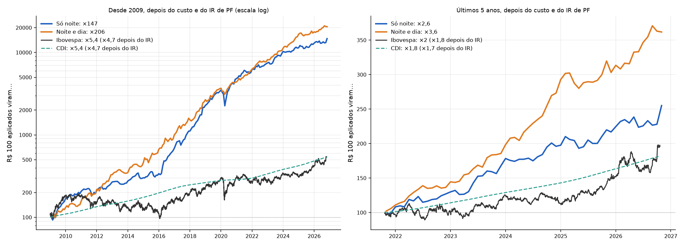

# A estratégia que vamos operar

Gerado por `uv run python -m overnight_br.decisao` (depois do pipeline e do selecao), com dados
até 21/10/2026. Código: [`decisao.py`](../src/overnight_br/decisao.py).

> Isto é resultado de pesquisa com dados históricos, não recomendação de investimento.

> **Atualização (23/10/2026):** a noite e dia ficou viável. Alugando as ações (BTC), a venda da
> manhã deixa de ser a descoberto, não há zeragem, e tudo acontece nos leilões. Com o custo do
> aluguel, ela rende 27,0% ao ano depois do IR nos últimos 5 anos, com Sharpe de 1,07 no pior
> subperíodo, e passa a ser a estratégia que vamos operar. A só noite vira plano C. Ver
> [`execucao.md`](execucao.md).

## Resposta curta

- **No papel,** a melhor estratégia para pessoa física, depois do custo e do imposto, é a **noite
  e dia**: comprada de noite e vendida de dia, nas mesmas 5 ações.
  - Tem o melhor Sharpe depois do IR nos últimos 5 anos e desde 2009.
  - Vai muito melhor no seu pior subperíodo.
  - A queda máxima dela é menos da metade da queda da só noite.
- **Na prática, vamos operar a só noite.** A noite e dia depende de recomprar o vendido no call
  de fechamento. Rico, Clear, BTG e Genial exigem fechar o day trade antes do call. Além disso,
  ela só cabe em lotes de 100 a partir de cerca de R$ 81 mil.
- **A escolha das 5 continua a média aparada.** As três variantes para eventos bruscos reduzem
  um pouco a perda nas noites de pânico, mas custam retorno. Nenhuma passou no critério.
- **A sua impressão sobre o mercado de lado está certa para a noite e dia.** Na só noite é o
  contrário: ela ganha mais quanto mais o mercado sobe.
- **Nos eventos bruscos, você está certo:** as ações de beta alto andam muito mais. A só noite
  dorme comprada nessas ações e sente o evento inteiro, para cima ou para baixo.
- **Corretora: Rico.** O plano da automação total está na seção 8.

| Últimos 5 anos, custo de PF | Antes do IR | **Depois do IR** | Pior queda mensal, depois do IR |
|---|---|---|---|
| **Só noite (a que vamos operar)** | 29,0% ao ano | **20,6% ao ano** | −8% |
| Noite e dia (melhor no papel) | 39,1% | 29,3% | −7% |
| Ibovespa | 14,4% | 12,7% | |
| CDI | 12,7% | 11,1% | |

---

## 1. As duas versões, depois do custo e do imposto

**O critério, fixado antes de rodar** (está no topo do `decisao.py`):
- a medida é o Sharpe depois do custo de pessoa física (2,8 bp por lado) e do imposto de pessoa
  física, com retornos mensais, sobre o CDI depois do IR;
- vale o **pior** dos quatro subperíodos;
- a noite e dia só ganharia se superasse a só noite por pelo menos 0,1.

| Sharpe depois do IR | 2006–2010 | 2011–2015 | 2016–2020 | 2021–2026 | **Pior** |
|---|---|---|---|---|---|
| Só noite | 1,35 | 0,15 | 1,82 | 0,78 | **0,15** |
| Noite e dia | 1,19 | 1,26 | 1,61 | 1,68 | **1,19** |

| Retorno ao ano, depois do IR | 2006–2010 | 2011–2015 | 2016–2020 | 2021–2026 |
|---|---|---|---|---|
| Só noite | 34,5% | **10,0%** | 63,2% | 20,8% |
| Noite e dia | 32,3% | 33,3% | 42,5% | 30,0% |
| CDI, depois do IR | 10,3% | 9,1% | 6,7% | 10,0% |

**Pelo critério, a noite e dia ganha com folga** (1,19 contra 0,15). O motivo está em 2011–2015:
- foram anos de bolsa caindo;
- a só noite rendeu 10,0% ao ano depois do IR, quase o mesmo que o CDI;
- a noite e dia rendeu 33,3%, porque a perna vendida ganhou com o pregão caindo.

Nos anos de alta (2016–2020), a só noite ganhou.

| | Só noite | Noite e dia |
|---|---|---|
| Retorno ao ano depois do IR, 2009–2026 | 32,4% | 34,9% |
| Sharpe depois do IR, 2009–2026 | 1,14 | 1,45 |
| Pior queda mensal depois do IR, 2009–2026 | −35,5% (COVID) | −15,6% |
| Volatilidade, 2009–2026 | 21,0% | 18,6% |
| Beta da carteira com a noite do mercado | 1,20 | 0,59 |

Fonte: [`decisao_tentativas.csv`](../results/decisao_tentativas.csv).

## 2. Por que, mesmo assim, vamos operar a só noite

### 2.1 A noite e dia precisa recomprar o vendido no call, e as corretoras não deixam

No backtest, a perna do dia vende no leilão de abertura e **recompra no call de fechamento**.
Para a pessoa física, essa venda é day trade a descoberto, e as corretoras exigem fechar o day
trade **antes** do call:

| Corretora | Regra que encontrei |
|---|---|
| Rico | posições de day trade encerradas até 15 minutos antes do fechamento do pregão regular; depois disso, as exigências passam a ser as de quem carrega a posição para o dia seguinte (Manual de Risco) |
| Clear | zerar até 5 minutos antes do leilão de encerramento; se não, o sistema zera no próprio leilão (manual de risco da Clear, citado numa reclamação) |
| BTG | encerrar até 5 minutos antes do call de fechamento (resposta da corretora a uma reclamação, dez/2025) |
| Genial | 15 minutos antes do call, ou seja, 16h40 (resposta da corretora a uma reclamação) |

**Duas saídas possíveis, e por que nenhuma serve agora:**
- **Recomprar antes do call, no pregão contínuo.** Muda a estratégia: a perna do dia deixaria de
  pegar o fim do pregão e o leilão de fechamento, e pagaria o spread. Isso não dá para testar com
  os dados diários do COTAHIST, então não sei se a perna do dia continua valendo.
- **Deixar a corretora zerar.** A liquidação compulsória custa 0,5% do volume, com mínimo de R$ 50,
  na Rico. Todo dia, isso destruiria a estratégia.

### 2.2 O capital: lotes de 100

Na noite e dia, cada ação recebe 10% do capital em cada perna. Com os preços de 21/10/2026, a
BPAC11 (R$ 80,56) só cabe em 1 lote com pelo menos cerca de R$ 81 mil:

| Capital | Noite e dia: comprado de noite | Só noite: comprado de noite |
|---|---|---|
| R$ 50 mil | 33% do capital, sem a BPAC11 | 86% |
| R$ 81 mil | 47% | 95% |
| R$ 100 mil | 43% | 92% |

**O mercado fracionário não resolve.** Comparei 2025 e 2026 no COTAHIST (tipo de mercado 020),
em 9 ações grandes, inclusive as da carteira atual:
- os preços de abertura e fechamento do fracionário diferem dos do lote padrão em 11 a 70 bp por
  dia (mediana da diferença absoluta);
- a noite medida no fracionário sai 5 bp pior, em média, que no lote padrão;
- na MGLU3, sai 33 bp pior por noite; na HAPV3, 16 bp pior.

Isso é mais que todo o custo de 2,8 bp por lado. **A regra é operar só em lotes de 100.**

### 2.3 Quando a noite e dia volta à mesa

Ela volta se três coisas acontecerem:
1. uma corretora confirmar, por escrito, que o vendido de day trade pode ser recomprado no call
   de fechamento, com garantia suficiente, sem zeragem nem taxa;
2. o capital passar de cerca de R$ 81 mil;
3. a só noite estiver rodando sem erro, automatizada.

O código já monta a boleta das duas versões (`--versao noite_e_dia`).

## 3. O mercado de lado

Retorno médio por mês, com custo de PF e antes do IR, conforme o que o Ibovespa fez no mês
(2009 a 2026):

| Ibovespa no mês | Meses | Ibovespa | Só noite | Noite e dia | Só noite acima do CDI | Noite e dia acima do CDI |
|---|---|---|---|---|---|---|
| Queda forte (pior que −5%) | 24 | −9,1% | −1,7% | **+5,9%** | 38% | 79% |
| Queda (−5% a −2%) | 48 | −3,4% | +1,6% | **+4,4%** | 58% | 75% |
| **De lado (−2% a +2%)** | 51 | +0,1% | +2,7% | **+4,0%** | 69% | **82%** |
| Alta (+2% a +5%) | 38 | +3,3% | **+4,1%** | +2,5% | 79% | 66% |
| Alta forte (mais de +5%) | 53 | +8,7% | **+6,6%** | +0,9% | 87% | 45% |

Fonte: [`decisao_lateral.csv`](../results/decisao_lateral.csv).

- **Na noite e dia, a sua impressão está certa.** De lado, ela rende 4,0% ao mês e ganha do CDI
  em 82% dos meses, a maior taxa entre os cinco grupos. Na queda, rende ainda mais. Na alta forte,
  quase nada, porque a perna vendida apanha.
- **Na só noite, é o contrário.** Quanto mais o mercado sobe, mais ela rende. De lado, rende 2,7%
  ao mês, e ganha do CDI em 69% dos meses.
- **Não dá para saber antes se o mês vai ser de lado.** Os grupos acima usam o que o Ibovespa fez
  no próprio mês. Separando pelos 3 meses anteriores, que se conhecem na hora de decidir, os meses
  depois de um mercado de lado foram os piores para a só noite (2,3% ao mês, em
  [`so_noite.md`](so_noite.md), seção 8).

## 4. Eventos bruscos

### 4.1 Noite de evento

**Definição, fixada antes dos testes:** noite em que o mercado (a média das 50 mais líquidas) anda
2% ou mais, o que dá cerca de 2 desvios-padrão. Foram 166 noites de 2006 a 2026, 84 de queda e 82
de alta.

| Média no dia de uma noite de evento | Só noite | Noite e dia |
|---|---|---|
| Mercado caiu 2% ou mais de noite | −4,4% | −2,3% |
| Mercado subiu 2% ou mais de noite | +4,2% | +2,1% |
| Beta da carteira com a noite do mercado | 1,20 | 0,59 |

**A só noite amplifica o evento.** O beta dela com a noite do mercado é 1,2: ela escolhe as ações
que mais sobem de noite, e essas são também as de beta alto.

### 4.2 O dia seguinte ao 1º turno de 2026

Em 05/10/2026, as 50 mais líquidas abriram, em média, 6,7% acima do fechamento de sexta. Foi a 6ª
maior alta do mercado de noite desde 2006. Mas a alta não foi igual para todas:

| | Noite de 05/10/2026 |
|---|---|
| As 5 que mais subiram | B3SA3 +16,3%, BPAC11 +15,1%, CYRE3 +15,0%, ASAI3 +15,0%, HAPV3 +14,1% |
| As 5 que menos subiram | UGPA3 −0,5%, KLBN11 −0,3%, BRAV3 +0,5%, GGBR4 +1,0%, VIVT3 +1,1% |
| A carteira de outubro | HAPV3 +14,1%, MGLU3 +10,8%, ALOS3 +6,2%, CMIG4 +4,3%, BBSE3 +3,6% |

**O beta previu quem andaria mais.** Entre as 50, a correlação entre o beta de noite de cada ação,
medido até 29/09, e a noite de 05/10 foi de 0,62. Na carteira de outubro:
- a HAPV3 e a MGLU3 tinham beta de 1,89 e 1,64 e subiram 14,1% e 10,8%;
- a BBSE3 tinha beta de 0,38 e subiu 3,6%.

A mediana das 50 era 1,08.

### 4.3 As noites de eleição

| Turno | Pregão seguinte | Mercado de noite | Só noite | Noite e dia |
|---|---|---|---|---|
| 2014, 1º turno | 06/10/2014 | +5,6% | +5,3% | +3,7% |
| 2014, 2º turno | 27/10/2014 | −5,1% | −6,9% | −5,1% |
| 2018, 1º turno | 08/10/2018 | +5,7% | +4,2% | +2,4% |
| 2018, 2º turno | 29/10/2018 | +2,8% | +3,2% | +3,8% |
| 2022, 1º turno | 03/10/2022 | +3,2% | +3,6% | +1,4% |
| 2022, 2º turno | 31/10/2022 | −1,7% | −2,5% | −2,6% |
| 2026, 1º turno | 05/10/2026 | +6,7% | +7,7% | +2,8% |

Eleição é uma aposta binária de noite: em 7 turnos, a só noite ganhou em 5 e perdeu em 2, com
movimentos de 2% a 8% numa noite. **O 2º turno de 2026 é no domingo, 25/10.** A abertura de
segunda, 26/10, é a próxima noite de evento.

### 4.4 Janelas de eventos conhecidos

Retorno acumulado na janela, com custo de PF:

| Evento | Mercado (50 mais líquidas) | Ibovespa | Só noite | Noite e dia |
|---|---|---|---|---|
| Crise de 2008 (set–nov) | −33,1% | — | −2,8% | +43,1% |
| Rebaixamento dos EUA, 2011 | −1,1% | −4,2% | −9,8% | −9,0% |
| Eleição de 2014 (outubro) | +0,6% | +0,6% | −4,0% | −0,7% |
| Joesley Day, 2017 (17/05 a 30/06) | −6,5% | −8,3% | −9,6% | −2,4% |
| Greve dos caminhoneiros, 2018 | −9,2% | −12,3% | +6,6% | +13,0% |
| Eleição de 2018 (outubro) | +9,5% | +9,8% | +25,1% | +18,7% |
| COVID, 2020 (20/02 a 30/04) | −31,8% | −31,1% | −19,8% | −4,4% |
| Eleição de 2022 (outubro) | +8,8% | +5,3% | +3,9% | −2,3% |
| Tarifas dos EUA, abril de 2025 | +5,7% | +3,4% | −5,5% | −2,5% |
| Eleição de 2026 (1º a 21/10) | +16,6% | +10,5% | +11,9% | −0,3% |

Fonte: [`decisao_eventos.csv`](../results/decisao_eventos.csv). O BOVA11 começa em dezembro de
2008, por isso a crise de 2008 só tem a média das 50 mais líquidas.

- **Nas grandes quedas,** a só noite perdeu bem menos que o mercado, e a noite e dia quase nada
  ou até ganhou. Foi o caso da crise de 2008 e da COVID.
- **Nas quedas concentradas em uma ou duas noites,** a só noite perdeu mais que o mercado. Foi o
  caso de agosto de 2011 e do Joesley Day.
- **Nas altas de eleição,** a só noite subiu junto com o mercado (2018: +25,1%; 2026: +11,9%).
  A noite e dia ficou para trás em 2022 e 2026.

### 4.5 Variações da escolha das 5 para eventos bruscos

Três variantes, cada uma mirando o problema que você apontou:

| Variante | A ideia |
|---|---|
| **Alfa** | a média aparada da noite da ação depois de tirar o efeito do mercado (noite da ação menos beta vezes a noite do mercado). Não escolhe uma ação só porque o beta alto a fez subir numa fase de alta |
| **Sem eventos** | a média aparada sem as noites em que o mercado andou 2% ou mais |
| **Teto de beta** | a média aparada, mas sem as 20% de maior beta de noite entre as 50 |

O critério: substituir a média aparada só se melhorar o Sharpe depois do IR, no pior
subperíodo, em pelo menos 0,1.

| | Sharpe depois do IR, pior período | Depois do IR, 5 anos | Depois do IR, 2009–2026 | Pior queda mensal depois do IR, 2009–2026 | Noite de queda do mercado, média | Beta de noite |
|---|---|---|---|---|---|---|
| **Só noite** | | | | | | |
| Média aparada (atual) | **0,15** | **20,6%** | **32,4%** | −35,5% | −4,4% | 1,20 |
| Alfa | −0,15 | 19,9% | 27,9% | −31,7% | −3,7% | 1,01 |
| Sem eventos | 0,20 | 19,7% | 31,5% | −35,3% | −4,4% | 1,20 |
| Teto de beta | −0,56 | 16,1% | 18,2% | −31,8% | −3,5% | 0,96 |
| **Noite e dia** | | | | | | |
| Média aparada (atual) | **1,19** | **29,3%** | **34,9%** | −15,6% | −2,3% | 0,59 |
| Alfa | 1,01 | 18,9% | 27,7% | −13,2% | −1,9% | 0,50 |
| Sem eventos | 1,05 | 29,0% | 33,4% | −15,5% | −2,3% | 0,59 |
| Teto de beta | 0,43 | 17,2% | 18,1% | −16,2% | −1,8% | 0,47 |

**Nenhuma variante passou.** A melhor na só noite foi a "sem eventos", com 0,20 contra 0,15, uma
diferença de 0,05 que fica abaixo do limite de 0,1.

Nos eventos, a variante alfa ajuda na só noite:
- na COVID, perdeu 14,5% contra 19,8%;
- no Joesley Day, ganhou 5,5% contra uma perda de 9,6%.

Mas ela perde no rebaixamento de 2011, na eleição de 2026 e no total.

O padrão é o mesmo nas duas versões:
- tirar o beta reduz a perda nas noites de pânico (de −4,4% para −3,5% a −3,7% na só noite);
- mas reduz mais o retorno. As ações de beta alto são justamente as que pagam o prêmio da noite.

O risco do evento faz parte da estratégia, e trocar as ações não o tira.

### 4.6 Então como controlar o risco de evento

- **Pelo tamanho da aposta, não pela escolha das ações.** Com metade do dinheiro na só noite e
  metade no Tesouro Selic, a queda da COVID teria sido mais ou menos a metade. O excesso sobre o
  CDI também cai à metade.
- **Fim de semana de eleição é uma escolha sua.**
  - Dormir fora custa uma noite de prêmio: em média, 0,15% desde 2009 e 0,07% desde 2025, já
    com o custo.
  - Nas 7 noites de eleição desde 2014, ficar fora teria custado dinheiro: a só noite ganhou em 5.
  - Isso não é regra: são só 7 casos.

## 5. A estratégia: como funciona

**A teoria** (detalhes em [`como_operar.md`](como_operar.md), Parte 1):
- **No leilão de fechamento, muita gente precisa vender:** o day trader alavancado é zerado, o
  formador de mercado não quer dormir com estoque, e quem teme a notícia da madrugada sai. O
  preço de fechamento sai um pouco barato.
- **No leilão de abertura, muita gente quer comprar:** é a pessoa física que leu a notícia à
  noite. O preço de abertura sai um pouco caro.
- **A estratégia compra de quem precisa vender e vende para quem quer comprar,** e carrega o risco
  da noite. É paga por esse serviço.
- **A clientela persiste:** a ação que subiu de noite nos últimos 12 meses tende a continuar
  subindo de noite. Por isso a escolha olha para trás 12 meses.

**A prática:**
1. **Uma vez por mês,** no último pregão, com os dados até a véspera: entre as 50 ações mais
   líquidas (preço acima de R$ 5, fora de recuperação judicial), as 5 com a maior média aparada
   da noite nos últimos 12 meses. Peso igual.
2. **Todo dia, às 9h45:** vende tudo no leilão de abertura.
3. **Todo dia, às 16h55 (17h55 fora do horário de verão americano):** compra as 5 no call de
   fechamento, com o dinheiro da venda da manhã.
4. **No último pregão do mês,** a compra da tarde já usa a carteira do mês seguinte.
5. **Só lotes de 100, só ordens nos leilões,** nunca pelo telefone da mesa.

**A carteira de novembro (prévia, com os dados até 21/10):** MGLU3, HAPV3, ALOS3, CMIG4 e BPAC11.
A escolha oficial sai em 30/10.

## 6. Por que vamos operar ela

**A evidência:**
- **Ganhou do CDI antes do IR em 17 de 18 anos,** de 2009 a 2026. A exceção foi 2025, que
  praticamente empatou: 14,1% contra 14,3%.
- **Desde 2009, rendeu 32,4% ao ano depois do custo e do imposto de pessoa física.** O
  Ibovespa e o CDI renderam 9,1% cada, também depois do IR (15% no resgate).
- **Não é sorte:**
  - o Sharpe antes do IR desde 2009 (1,38) passa com folga do limite de sorte para as 517
    tentativas feitas no projeto (0,84);
  - todas as 180 regras de escolha testadas ganharam do CDI no período longo.
- **É a mais simples de operar:**
  - nunca fica vendida, não usa margem e não depende de regra de zeragem;
  - cabe em lotes de 100 a partir de cerca de R$ 41 mil.

**Os riscos, sem enfeite:**
- **Pior queda:** −46% na COVID, em cinco semanas. Pior noite: −20% (12/03/2020).
- **Nas altas fortes, fica atrás do Ibovespa,** como em 2025 e 2026.
- **O efeito encolheu:** de 52% a 118% ao ano em 2016–2020, para 14% a 18% em 2025–2026.
- **Em anos de bolsa caindo,** como 2011–2015, ela rendeu quase só o CDI depois do IR.

**Regras para parar** (decididas antes, em [`como_operar.md`](como_operar.md), Parte 7):
- custo de execução acima de 2 bp por lado, além da tarifa, por um mês;
- um erro operacional sério;
- 6 meses ao vivo abaixo do CDI, com o papel também abaixo;
- mudança na tarifa, no imposto ou nos horários dos leilões.

## 7. A corretora: Rico

A análise completa está em [`so_noite.md`](so_noite.md), seção 10. O resumo:
- **Custo:** corretagem zero em ações, na venda da manhã e na compra da tarde.
- **Automação:** o MetaTrader 5 é grátis para clientes. Falta confirmar que ele opera ações à vista
  com posição de um dia para o outro. A outra opção é o Profit com a ProfitDLL.
- **Antes de transferir o dinheiro,** mande por escrito as 6 perguntas de `so_noite.md`, seção
  10.4. Acrescente uma sétima, para o futuro: "Posso vender a descoberto em day trade e recomprar
  no call de fechamento, com garantia suficiente, sem zeragem nem taxa?"
- **Plano B:** Genial, se o MT5 da Rico não servir para ações.

## 8. O plano da automação 100%

**Hoje,** o sistema já faz sozinho, todo dia útil, no Agendador do Windows:
- baixa os dados da B3;
- escolhe a carteira do mês;
- atualiza o teste em papel;
- monta a boleta de cada leilão.

Também já mede o custo das execuções. Falta só **mandar as ordens**.

**O que vou construir** (depois que a corretora responder):

| Peça | O que faz |
|---|---|
| Adaptador da corretora | uma interface única (posição, enviar, consultar, cancelar), com três versões: simulada, MetaTrader 5 (pacote Python oficial) ou ProfitDLL |
| Executor | às 9h46, confere a posição real, manda a venda de cada ação no leilão de abertura e confere a execução às 10h01. Às 16h56 (ou 17h56), manda as compras no call e confere às 17h01 |
| Travas | começa em modo simulado; teto por ordem e por dia; nunca vende mais do que tem; um arquivo `PARAR` desliga tudo; registra cada ordem com horário e preço |
| Alertas | um aviso no celular quando algo não executa, quando a posição não bate ou quando o computador não rodou |
| Imposto | o cálculo mensal do DARF, a partir das execuções reais, separando day trade e operação comum |

**O que preciso de você:**
1. Abrir a conta na Rico e mandar as perguntas por escrito.
2. Com a resposta, escolher entre o MetaTrader 5 e a ProfitDLL, e me dar acesso à conta de
   demonstração.
3. Um computador Windows ligado nos dias úteis, das 8h às 17h10 (até 18h10 de novembro a março,
   quando o call passa para 17h55). Pode ser o seu ou uma máquina virtual na nuvem, no Brasil.
4. Guardar a senha num arquivo local, fora do git. O repositório é público.

**As fases, cada uma com critério para avançar:**

| Fase | O que roda | Para avançar |
|---|---|---|
| 1. Papel | o comando `papel` já existe; com o agendador, atualiza todo dia | 20 pregões sem falha na rotina |
| 2. Conta de demonstração | o executor completo, sem dinheiro | 2 semanas com as execuções iguais às da boleta |
| 3. Dinheiro pequeno | R$ 20 mil, a BPAC11 fica de fora | 1 a 2 meses com custo medido abaixo de ~1,5 bp por lado, além da tarifa |
| 4. Capital pretendido | tudo automático, com os alertas | — |

## 9. Como reproduzir

    uv run python -m overnight_br.pipeline   # dados
    uv run python -m overnight_br.selecao    # os sinais, inclusive beta, alfa e sem eventos
    uv run python -m overnight_br.decisao    # esta decisão (~4 min)

## Fontes

- Regras de day trade das corretoras:
  - [Rico, Manual de Risco](https://www.rico.com.vc/documentos/manual-de-riscos/)
  - [Rico, custos](https://www.rico.com.vc/custos/)
  - [Clear, zeragem compulsória](https://master.clear.com.br/zeragem-compulsoria/)
  - [Clear, citação do manual de risco](https://www.reclameaqui.com.br/clear-corretora-de-valores/zeragem-compulsoria-injusta-e-falha-de-comunicacao-entre-clear-e-profit_Hvt0Ay0DEXdyvEaL/)
  - [BTG](https://www.reclameaqui.com.br/btg-pactual-digital/impedimento-de-encerramento-de-daytrade-e-cobranca-de-taxa-compulsoria-na-b_VX9CNZzDsdQd23_P/)
  - [Genial](https://www.reclameaqui.com.br/genial-investimentos/cobrancas-indevidas-com-acoes-em-day-trader_R1bJmCq0vy5nRHFr/)
- Data do 2º turno de 2026:
  - [Congresso em Foco](https://www.congressoemfoco.com.br/noticia/123236/quando-e-qual-e-o-dia-do-segundo-turno-das-eleicoes-2026)
  - [Movimento Econômico](https://movimentoeconomico.com.br/politica/eleicoes-2026/2026/10/04/quando-sera-o-segundo-turno-das-eleicoes-veja-a-data/)
- Corretoras, RLP e plataformas: ver as fontes de [`so_noite.md`](so_noite.md)
