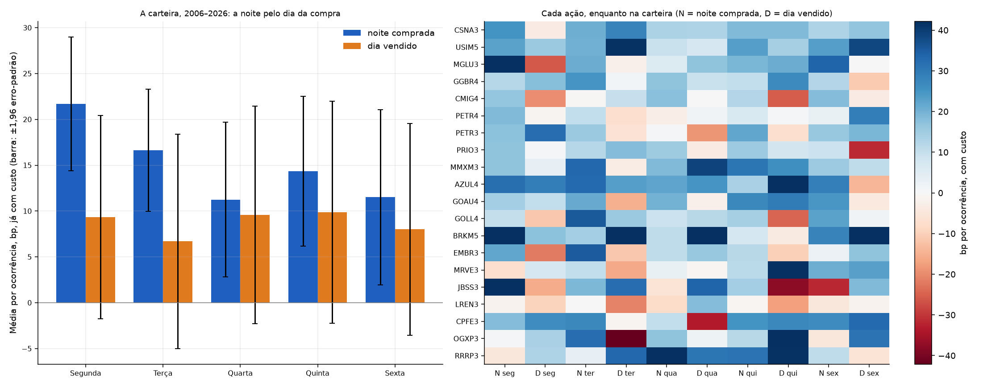

# Que dia da semana rende mais

Gerado por `uv run python -m overnight_br.dias_da_semana` (depois do pipeline e do selecao), com
dados até 21/10/2026. Código: [`dias_da_semana.py`](../src/overnight_br/dias_da_semana.py).

> Isto é resultado de pesquisa com dados históricos, não recomendação de investimento.

## Resposta curta

- **As 10 pernas dão lucro, já com o custo da versão operada.** Isso vale para a noite comprada e
  para o dia vendido, nos 5 dias da semana.
- **A melhor é a noite comprada na segunda** (compra na segunda, vende na terça):
  - +21,7 bp por noite, já com custo;
  - positiva nos quatro subperíodos, como as de terça, quarta e quinta.
- **A mais fraca, hoje, é a noite comprada na quarta:**
  - caiu de +20,8 bp (2006–2010) para +3,6 bp (2021–2026);
  - nos últimos 5 anos, +0,9 bp.
- **O dia vendido é parecido em todos os dias:** de +6,7 bp (terça) a +9,9 bp (quinta).
- **As diferenças entre os dias são compatíveis com acaso.**
  - No teste de permutação, o p é de 0,37 nas noites e 0,997 nos dias.
  - O melhor dia de um subperíodo vira o pior em outro.
- **Decisão: nada muda.** Pela regra fixada antes de rodar, nenhuma perna-dia virou candidata a
  sair da operação.
- **Por ação, o ruído domina.** Uma ação passa poucos meses na carteira, e sobram poucas
  ocorrências por perna-dia (a ALOS3 tem ~7). Os números estão na tabela, mas não servem de regra.

## 1. As 10 pernas da carteira

**As pernas:**
- **Noite comprada:** compra no call de fechamento e vende no leilão de abertura do pregão
  seguinte. O rótulo é o dia da compra:
  - a "sexta" é a noite de sexta para segunda, com o fim de semana dentro;
  - a noite antes de um feriado leva o dia em que se comprou.
- **Dia vendido:** vende no leilão de abertura e recompra no mesmo dia.

**O custo é o da versão operada:**
- noite: 2 × 2,8 bp;
- dia: 2 × 2,8 bp mais meio tick, porque recompra antes do call.

| 2006–2026, por ocorrência, já com custo | Ocorrências | Média | t | Vezes no positivo |
|---|---|---|---|---|
| **Noite comprada na segunda** | 1.026 | **+21,7 bp** | 5,8 | 59% |
| Noite comprada na terça | 1.031 | +16,6 bp | 4,9 | 60% |
| Noite comprada na quarta | 1.048 | +11,3 bp | 2,6 | 61% |
| Noite comprada na quinta | 1.027 | +14,3 bp | 3,4 | 58% |
| Noite comprada na sexta (fim de semana) | 1.022 | +11,5 bp | 2,4 | 59% |
| Dia vendido na segunda | 1.026 | +9,3 bp | 1,7 | 52% |
| Dia vendido na terça | 1.031 | +6,7 bp | 1,1 | 53% |
| Dia vendido na quarta | 1.049 | +9,6 bp | 1,6 | 52% |
| Dia vendido na quinta | 1.026 | +9,9 bp | 1,6 | 53% |
| Dia vendido na sexta | 1.022 | +8,0 bp | 1,4 | 50% |

Fonte: [`dias_da_semana_carteira.csv`](../results/dias_da_semana_carteira.csv), que traz também
o resultado antes do custo.
- **Antes do custo,** a noite vai de +17 a +27 bp e o dia de +16 a +19 bp, todos com t de 2,7 ou
  mais.
- **Somadas no ano, a perna do dia rende cerca de 60% da perna da noite:** +8,7 bp contra +15,1 bp
  por pregão, na média dos 5 dias.

## 2. Nos subperíodos

Média por ocorrência, em bp, já com custo:

| | 2006–2010 | 2011–2015 | 2016–2020 | 2021–2026 | Últimos 5 anos |
|---|---|---|---|---|---|
| **Noite comprada na segunda** | +13,8 | +7,8 | +49,5 | +16,7 | +17,2 |
| Noite comprada na terça | +14,5 | +19,5 | +20,7 | +12,6 | +9,8 |
| Noite comprada na quarta | +20,8 | +12,0 | +9,8 | **+3,6** | **+0,9** |
| Noite comprada na quinta | +12,2 | +9,2 | +26,0 | +10,5 | +10,1 |
| Noite comprada na sexta | +18,2 | **−6,5** | +23,1 | +11,5 | +14,0 |
| Dia vendido na segunda | +21,3 | +16,9 | −0,3 | +1,0 | **−2,5** |
| Dia vendido na terça | −7,1 | +10,7 | +14,8 | +8,1 | +2,8 |
| Dia vendido na quarta | −1,4 | +20,6 | +1,2 | +17,1 | +20,6 |
| Dia vendido na quinta | +18,6 | +0,5 | +2,7 | +16,8 | +16,7 |
| Dia vendido na sexta | −3,3 | +27,3 | +2,9 | +5,5 | +6,3 |

- **A ordem dos dias muda de um subperíodo para o outro.**
  - O dia vendido de quarta foi negativo em 2006–2010 e é o melhor dos últimos 5 anos.
  - O de segunda fez o caminho inverso: era o melhor em 2006–2010 e é o pior nos últimos 5 anos.
- **Duas coisas para acompanhar ao vivo, sem mudar nada agora:**
  - a noite comprada na quarta, que perdeu quase todo o prêmio nos últimos 5 anos;
  - o dia vendido de segunda, perto de zero desde 2016.

## 3. A regra, fixada antes de rodar

Uma perna-dia só viraria candidata a sair da operação se, na carteira:
1. o resultado de 2006 a 2026, já com custo, fosse negativo, com t abaixo de −2;
2. fosse negativo em pelo menos 3 dos 4 subperíodos;
3. o teste de permutação dissesse que as diferenças entre os dias não são acaso (p < 0,05).

**Nenhuma passou.** As 10 são positivas no período todo, e o teste de permutação dá p = 0,37 (noite)
e 0,997 (dia). Uma candidata, se houvesse, ainda seria testada em papel por 6 meses antes de mudar
a operação. Fonte: [`dias_da_semana_regra.csv`](../results/dias_da_semana_regra.csv).

## 4. Por ação

Média por ocorrência, já com custo, de cada ação **enquanto esteve na carteira**. Todas as ações
estão em [`dias_da_semana_por_acao.csv`](../results/dias_da_semana_por_acao.csv), com o número de
ocorrências e o t. A figura mostra as 20 que mais tempo passaram na carteira desde 2006.

As 5 de novembro de 2026, enquanto na carteira:

| | Ocorrências | N seg | N ter | N qua | N qui | N sex | D seg | D ter | D qua | D qui | D sex |
|---|---|---|---|---|---|---|---|---|---|---|---|
| MGLU3 | 2.330 | +49,6 | +21,0 | +5,8 | +19,4 | +33,7 | −25,9 | −2,0 | +16,9 | +20,9 | +0,2 |
| CMIG4 | 2.216 | +16,4 | −0,4 | +17,7 | +12,4 | +18,2 | −19,7 | +9,8 | +0,3 | −25,4 | −3,4 |
| HAPV3 | 235 | +37,6 | −0,3 | −85,1 | +23,1 | +90,7 | +5,6 | −41,0 | +183,7 | +18,6 | +32,7 |
| BPAC11 | 123 | +41,8 | −12,6 | −4,7 | −7,2 | −59,4 | +24,9 | +2,2 | −74,3 | −48,8 | −33,6 |
| ALOS3 | 69 | +53,7 | +0,3 | +6,5 | +9,3 | +77,8 | −116,4 | −48,9 | −51,0 | −65,4 | −42,7 |

N = noite comprada no dia; D = dia vendido no dia. As ocorrências são o total das 10 pernas.

- **Com 69 a 235 ocorrências, HAPV3, BPAC11 e ALOS3 têm 7 a 24 por perna-dia.** Um único dia
  extremo muda o sinal da média.
- **No histórico inteiro, desde 2009** (a ação estando ou não na carteira):
  - a noite comprada na segunda é a melhor em 4 das 5: MGLU3 (+26,7 bp), HAPV3 (+23,4 bp),
    BPAC11 (+21,0 bp) e CMIG4 (+10,3 bp). Na ALOS3, é a de sexta;
  - o resto não tem um padrão comum.
  - Fonte: [`dias_da_semana_novembro_historico.csv`](../results/dias_da_semana_novembro_historico.csv).

## 5. Como reproduzir

    uv run python -m overnight_br.dias_da_semana   # ~1 min
