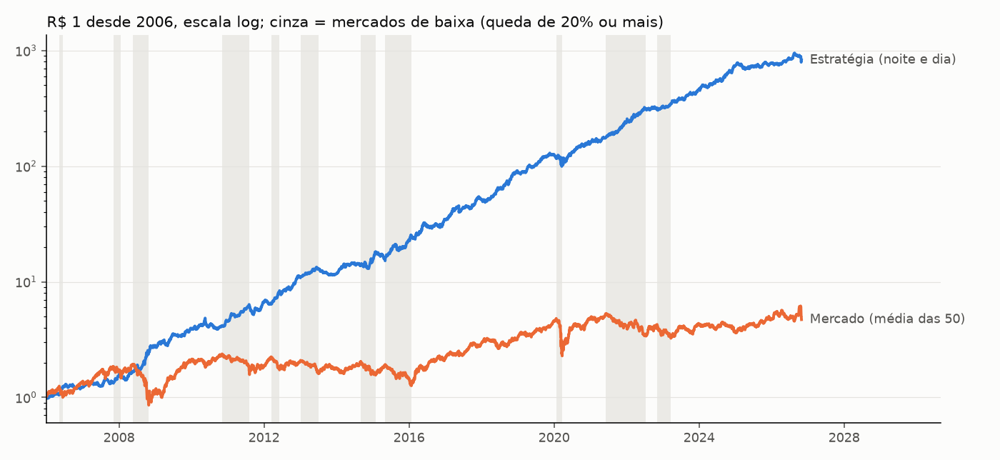

# Em que cenários a estratégia vai bem e mal: alta, baixa e o dia por dentro

Gerado por `uv run python scripts/regimes.py` em 04/11/2026. A regra atual na versão operada
(noite e dia, recompra antes do call), **com custo e antes do IR**, de jan/2006 a 29/10/2026.
Como "mercado" uso a média das 50 mais líquidas, que separa noite e pregão e cobre 2008; o
BOVA11 entra como referência desde 2009. Em 2006–15 a capacidade era menor (ver
[`refino.md`](refino.md)). Complementa os cenários mês a mês de [`cenarios.md`](cenarios.md).

## Resumo

1. **Nos mercados de baixa ela vai muito melhor.** Ganhou do mercado nos 11 mercados de baixa
   desde 2006 e do CDI em 10 deles: cerca de 88% ao ano, contra 30% ao ano nos de alta.
2. **Mas o que decide não é alta ou baixa: é *quando* o mercado anda.** Ela ganha quando o
   pregão cai e quando a noite sobe, e perde quando a noite cai e quando o pregão sobe. As
   baixas brasileiras aconteceram quase todas durante o pregão, por isso foram boas.
3. **O pior cenário é o choque de noite:** os 10 piores dias da história foram todos com o
   mercado abrindo em gap de baixa (Joesley Day, Covid, 26/10/2026, out/2008).
4. **Não dá para prever pelo regime.** Com a tendência de 12 meses do mercado, conhecida no
   começo do mês, a estratégia vai bem em todos os regimes (Sharpe de 1,1 a 1,9) e sem ordem.

## 1. Mercados de alta e de baixa (a regra dos 20%)

Uma baixa começa no topo de onde o mercado cai 20%; uma alta, no fundo de onde ele sobe 20%.

| | Episódios | Meses | Estratégia ao ano | CDI ao ano | Ganhou do mercado | Ganhou do CDI |
|---|---|---|---|---|---|---|
| Baixa | 11 | 60 | **88%** | 11% | **11 de 11** | 10 de 11 |
| Alta | 12 | 186 | 30% | 11% | 3 de 12 | 7 de 12 |

**Por dentro das baixas:** a perna da noite fica perto de zero e a perna vendida do dia ganha
muito, porque a queda do mercado acontece no pregão.

| Baixa | Meses | Estratégia | Perna da noite | Perna do dia | Mercado | Pregão do mercado |
|---|---|---|---|---|---|---|
| mai–out/2008 (crise) | 5 | +44,7% | −12,9% | +117,6% | −55,8% | −48,8% |
| nov/2010–ago/2011 | 9 | +50,6% | +1,6% | +102,1% | −33,8% | −35,0% |
| mai/2015–jan/2016 | 9 | +65,6% | +7,1% | +125,8% | −34,4% | −33,0% |
| jun/2021–jul/2022 | 13 | +77,8% | +28,2% | +116,6% | −36,3% | −44,8% |
| **jan–mar/2020 (Covid)** | 2 | **−3,5%** | −38,5% | +40,2% | −52,6% | −28,3% |

A única baixa ruim foi a do Covid, a única em que **a queda veio de noite**: a perna da noite
perdeu 38,5% e a do dia não compensou.

**Por dentro das altas:** as boas são as altas que vêm de noite; as ruins são os ralis no pregão.

| Alta | Meses | Estratégia | Perna da noite | Perna do dia | CDI | Noite do mercado | Pregão do mercado |
|---|---|---|---|---|---|---|---|
| jan/2016–jan/2020 | 47 | +362% | +1.197% | +2,8% | +40% | +276% | +1,3% |
| mar/2020–jun/2021 | 14 | +56,7% | +209% | −26,1% | +2,9% | +125% | +3,4% |
| mar/2023–out/2026 | 42 | +151% | +155% | +48,1% | +55% | +128% | −16,6% |
| jun/2006–nov/2007 | 16 | +8,4% | +61,5% | −40,0% | +18,3% | +59,8% | +15,7% |
| jul/2013–set/2014 | 14 | +7,7% | +40,0% | −27,2% | +11,7% | +41,9% | −10,0% |
| **jan–mai/2015** | 3 | **−16,5%** | +9,4% | −38,8% | +2,9% | +2,8% | +20,4% |

Fevereiro a maio de 2015 é o caso extremo: o mercado subiu 24%, quase tudo no pregão, e a perna
vendida perdeu 39%. É o mesmo cenário dos meses ruins de 2025 e 2026 (ver `cenarios.md` 3.6).

## 2. O dia por dentro: o que realmente importa

Cada pregão de 2006 a 2026, pela direção da noite e do pregão do mercado (bp por pregão):

| Noite do mercado | Pregão do mercado | % dos dias | Estratégia | Perna da noite | Perna do dia |
|---|---|---|---|---|---|
| sobe | cai | 30% | **+99** | +77 | +116 |
| cai | cai | 21% | +35 | −68 | +134 |
| sobe | sobe | 29% | −11 | +78 | −105 |
| cai | sobe | 20% | **−98** | −79 | −121 |

Pela força do movimento (quintis), o resultado anda em linha reta:

| Pregão do mercado | cai muito | | | | sobe muito |
|---|---|---|---|---|---|
| Estratégia (bp) | +118 | +52 | +16 | −26 | −92 |

| Noite do mercado | cai muito | | | | sobe muito |
|---|---|---|---|---|---|
| Estratégia (bp) | −60 | −3 | +21 | +35 | +74 |

**Leitura:** a estratégia é comprada na noite e vendida no pregão, e é isso que ela "aposta". Um
mercado de baixa só é bom quando cai no pregão; um de alta só é ruim quando sobe no pregão.

## 3. Contra o Ibovespa (mensal, 2009–2026)

| | Mês de alta do BOVA11 (118) | Mês de baixa (96) | Beta na alta | Beta na baixa | Correlação |
|---|---|---|---|---|---|
| BOVA11 | +5,1% | −4,3% | 1 | 1 | 1 |
| **Noite e dia** | +1,7% | **+4,1%** | −0,28 | +0,08 | **−0,23** |
| Só noite | +4,9% | +0,7% | +0,54 | +0,76 | +0,57 |

- **A versão completa é um seguro contra a queda:** ela rende mais nos meses ruins da bolsa do
  que nos bons, e anda levemente contra o Ibovespa.
- **A só noite é o contrário:** pega quase toda a alta e, na baixa, cai junto (beta de 0,76
  na baixa contra 0,54 na alta). É a perna do dia que transforma a estratégia em proteção.

## 4. Dá para saber o regime antes? Não

A tendência do mercado nos 12 meses anteriores, conhecida no começo de cada mês:

| Tendência de 12 meses | Meses | Estratégia no mês | Mercado no mês | Meses acima do CDI | Sharpe |
|---|---|---|---|---|---|
| abaixo de −10% | 46 | +3,1% | +2,3% | 65% | 1,39 |
| −10% a 0 | 41 | +2,6% | +1,1% | 59% | 1,06 |
| 0 a +10% | 42 | +3,8% | −0,3% | 64% | 1,89 |
| +10% a +25% | 50 | +2,4% | −0,5% | 62% | 1,11 |
| acima de +25% | 59 | +2,7% | +1,1% | 71% | 1,47 |

Nenhum regime é ruim e não há ordem entre eles. Ligar e desligar pela tendência não ajudaria.

## 5. Os piores e os melhores dias

| Pior dia | Estratégia | Perna da noite | Perna do dia | Noite do mercado | Pregão do mercado |
|---|---|---|---|---|---|
| 18/05/2017 (Joesley Day) | −12,2% | −18,5% | −6,0% | −12,9% | +6,0% |
| 26/10/2026 | −10,6% | −27,2% | +6,0% | −22,7% | +5,4% |
| 12/03/2020 (Covid) | −9,9% | −20,1% | +0,3% | −15,0% | −2,5% |
| 19/03/2020 (Covid) | −9,4% | −5,0% | −13,8% | −4,0% | +7,1% |
| 16/03/2020 (Covid) | −8,0% | −17,9% | +1,9% | −14,4% | −0,9% |

- **Os 10 piores dias tiveram, todos, gap de baixa na abertura**, quase sempre seguido de
  repique no pregão: as duas pernas perdem juntas.
- **Os melhores dias são os repiques depois desses choques** (13/03/2020: +9,7%;
  out/2008), em geral com o mercado abrindo em alta.

## O que isso diz sobre agora

- Pela regra dos 20%, a alta que começou em mar/2023 terminou no topo de 20/10/2026; a queda de
  26/10 abriu uma baixa (ainda curta demais para entrar nas tabelas).
- O começo dela foi o pior caso para a estratégia, um choque de noite, como no Covid. O que vem
  depois depende de onde o mercado andar: se a queda continuar no pregão, é o cenário em que a
  estratégia sempre foi melhor; se vierem mais gaps de baixa, é o cenário em que ela perde.
- Isto descreve o passado e não é previsão nem recomendação.
