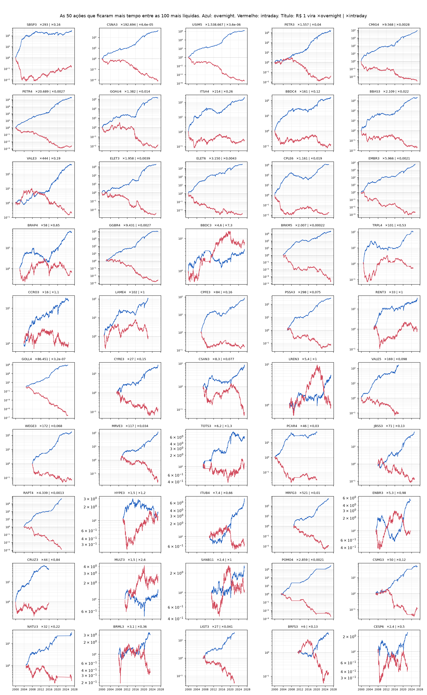

# Passo 1: overnight vs intraday nas 100 ações mais líquidas da B3

Gerado por `uv run python -m overnight_br.pipeline` em 21/10/2026, com dados até 20/10/2026.
Como os preços foram tratados, e por quê: [`tratamento_dos_precos.md`](tratamento_dos_precos.md).

**Em uma frase:** o padrão da Micron existe no Brasil, e é forte. Nas ações mais líquidas da
B3, quase todo o ganho acontece entre o fechamento e a abertura. Durante o pregão, o preço cai.

## 1. A carteira das 100 mais líquidas (sem viés de sobrevivência)

Cada dia de 2000 a 2026: média simples das ações que estavam no universo naquele ano (cerca de
94 por dia), uma média para cada perna, acumulada.

| | Overnight | Intraday |
|---|---|---|
| R$ 1 em 03/01/2000 vira, em 20/10/2026 | **R$ 1.428** | **R$ 0,03** (−96,9%) |
| Média por dia | +11,3 bp | −4,5 bp |
| Média por dia em log (sem o bônus do rebalanceamento diário) | +10,3 bp | −7,8 bp |
| Anos em que a perna ganhou da outra | 26 de 27 | 1 de 27 (2003) |

As médias diárias ficam a 10,8 e −3,1 erros-padrão de zero. É um t simples, sem correção de
autocorrelação, então serve só como ordem de grandeza.

## 2. Ação por ação: as "Microns brasileiras"

Cada um dos **363 tickers** que passaram pelo universo, vivos ou mortos, com as duas pernas
acumuladas nos anos em que esteve entre os 100. A tabela completa, sem filtro, está em
[`results/por_acao.csv`](../results/por_acao.csv).

- **277 das 363 (76%)** têm o overnight acima do intraday.
- A mais extrema é a **USIM5 (Usiminas)**. Comprando no fechamento e vendendo na abertura,
  todo dia, por 27 anos, R$ 1 vira **R$ 1,54 milhão (+153.866.610%)**. Fazendo o contrário,
  vira **R$ 0,0000036 (−99,9996%)**. A imagem viral da Micron diz +138.330.342% e −99,2%.
  - Não são poucos saltos. É uma deriva de **+21,6 bp por noite e −18,9 bp por pregão**.
  - Tirando as 10 maiores noites, o overnight da USIM5 sobe, para ×2,05 milhões.

As 10 com a maior distância entre as duas curvas no fim:

| Ação | Anos no universo | Overnight: R$ 1 vira | Intraday | Média por noite | Média por pregão |
|---|---|---|---|---|---|
| USIM5 Usiminas | 27 | R$ 1.538.667 | −99,9996% | +21,6 bp | −18,9 bp |
| GOLL4 Gol | 20 | R$ 86.451 | −99,99997% | +23,1 bp | −30,2 bp |
| CSNA3 CSN | 27 | R$ 192.694 | −99,993% | +18,5 bp | −14,5 bp |
| PLIM4 Net | 6 | R$ 924 | −99,998% | +51,8 bp | −80,3 bp |
| INEP4 Inepar | 5 | R$ 784 | −99,996% | +53,8 bp | −82,1 bp |
| OIBR4 Oi | 6 | R$ 689 | −99,997% | +44,2 bp | −69,3 bp |
| CNFB4 Confab | 11 | R$ 12.336 | −99,87% | +35,0 bp | −24,4 bp |
| BRKM5 Braskem | 23 | R$ 2.007 | −99,98% | +13,5 bp | −14,9 bp |
| PETR4 Petrobras | 27 | R$ 20.689 | −99,73% | +15,2 bp | −8,9 bp |
| OIBR3 Oi | 7 | R$ 286 | −99,993% | +32,6 bp | −55,5 bp |

Médias em log. O ranking não tem filtro de tempo mínimo: Net, Inepar e Oi entram com poucos
anos e médias diárias enormes.

Algumas das maiores, para referência:

| Ação | Anos | Overnight: R$ 1 vira | Intraday |
|---|---|---|---|
| BBAS3 | 27 | R$ 2.109 | −97,8% |
| VALE3 | 27 | R$ 444 | −80,9% |
| WEGE3 | 18 | R$ 172 | −93,2% |
| BBDC4 | 27 | R$ 161 | −87,8% |
| ITUB4 | 17 | R$ 7,4 | −33,9% |
| ABEV3 | 12 | R$ 1,34 | +21,1% |
| B3SA3 | 8 | R$ 1,19 | +183,3% |

**As 86 que invertem o padrão** são, quase todas, ações pouco negociadas (mediana de 63
negócios por dia, contra 2.866 nas outras), a maioria teles do começo dos anos 2000:

| Negócios por dia (mediana) | Ações | Com overnight > intraday |
|---|---|---|
| menos de 50 | 74 | 43% |
| 50 a 200 | 46 | 85% |
| 200 a 1.000 | 44 | 82% |
| 1.000 a 5.000 | 80 | 90% |
| mais de 5.000 | 119 | 82% |

Isso é o que se espera de abertura "velha": em ação que mal negocia, o primeiro negócio sai
perto do preço de ontem, e o movimento do dia vai todo para o intraday.

## 3. A grade

As 50 ações que passaram mais pregões entre as 100 mais líquidas, incluindo as que morreram
(VALE5, PCAR4, TRPL4, CRUZ3...). Azul é o overnight; vermelho, o intraday.

## 4. O que isto ainda não diz

- **Não é estratégia.** Comprar no fechamento e vender na abertura são duas operações por dia.
  Custo, imposto e o tamanho dos leilões ainda não entraram. Os ETFs americanos que tentaram
  isso fecharam em cerca de um ano.
- **CDI.** Numa checagem preliminar, ainda fora do pipeline, o CDI acumulou ×20,9 no mesmo
  período: 4,6 bp por pregão, contra 11,3 bp do overnight. Explica menos da metade da perna
  noturna e nada do intraday negativo. Entra na conta no próximo passo.
- **Por que acontece.** O Knuteson diz que são quant funds grandes. A literatura tem
  alternativas (ver [`knuteson_micron.md`](knuteson_micron.md)). Este passo só mede.
