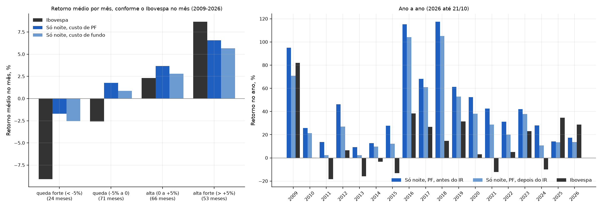
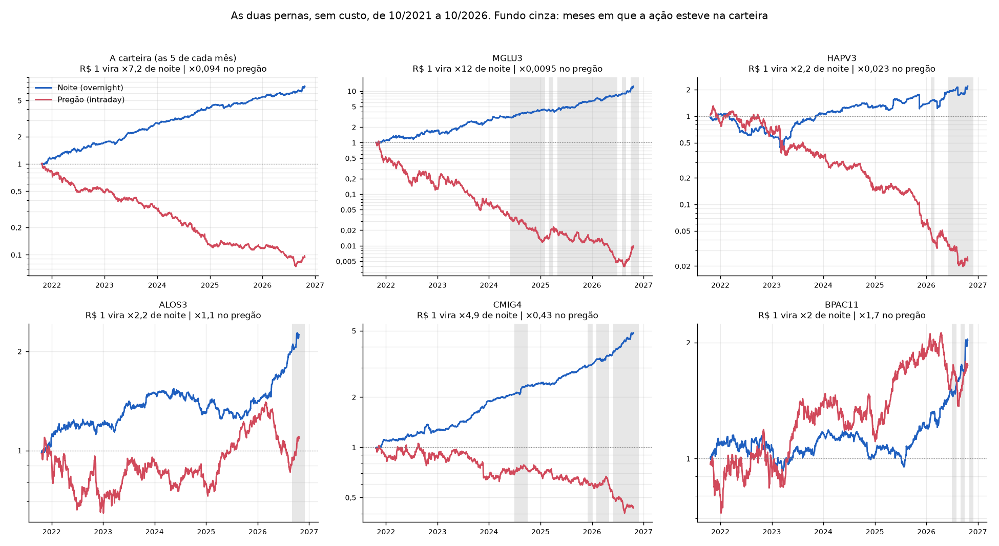

# Só de noite: compra no fechamento, vende na abertura

Gerado por `uv run python -m overnight_br.selecao` e `uv run python -m overnight_br.so_noite`
(depois do pipeline), com dados até 21/10/2026. Código:
[`selecao.py`](../src/overnight_br/selecao.py) e [`so_noite.py`](../src/overnight_br/so_noite.py).

> Isto é resultado de pesquisa com dados históricos, não recomendação de investimento.

**Decisão final, depois deste relatório:** a só noite é a estratégia que vamos operar. O porquê,
a comparação com a versão completa depois do IR e os testes com eventos bruscos estão em
[`decisao.md`](decisao.md).

**A pergunta:** e se a gente só operar a noite? Compra no leilão de fechamento, vende no leilão
de abertura do dia seguinte e **nunca fica vendido**. À tarde compra de novo, e assim por diante.

**Resposta curta:** funciona, e é a versão mais simples de operar. Nos últimos 5 anos, com custo
de pessoa física, rendeu **29,0% ao ano antes do imposto e 20,6% depois**. No mesmo período, o
Ibovespa rendeu 14,4% (12,7% depois do IR) e o CDI 12,7% (11,1%). A volatilidade foi menor que a
do Ibovespa, e a pior queda foi a metade da dele.

| Últimos 5 anos | Retorno ao ano | Volatilidade | Sharpe | Pior queda |
|---|---|---|---|---|
| Ibovespa | 14,4% | 18,3% | 0,18 | −21,0% |
| CDI | 12,7% | — | — | — |
| **Só noite, custo de pessoa física (2,8 bp por lado)** | **29,0%** | **14,7%** | **1,00** | **−11,2%** |
| Só noite, custo de fundo (4,9 bp por lado) | 16,2% | 14,7% | 0,28 | −12,8% |
| *As mesmas 5 ações, compradas e seguradas* | *−8,0%* | *30,5%* | *−0,52* | *−56,9%* |

**Três ressalvas que vêm junto:**
1. **O risco é a noite de pânico.** A estratégia dorme 100% comprada. Na COVID, ela caiu 46%
   em cinco semanas (12/02 a 19/03/2020) e só recuperou em junho. Nas 10 piores noites, o
   Ibovespa também caiu de noite (seção 9).
2. **Nas altas fortes, fica atrás do Ibovespa.** Em 2025 e 2026 rendeu menos que ele. Em 2025,
   empatou com o CDI (14,1% contra 14,3%).
3. **Os últimos 5 anos sozinhos não provam nada.** O período longo prova (seção 3). Os últimos
   5 anos são compatíveis com ele.

---

## 1. Como a estratégia funciona

| Período (horário de Brasília) | Só noite | Versão completa (passos 4 e 5) |
|---|---|---|
| Leilão de fechamento até o leilão de abertura seguinte, fins de semana inclusive | **comprado** nas 5, com todo o dinheiro | comprado nas 5, com metade do dinheiro |
| Leilão de abertura até o leilão de fechamento | nada: o dinheiro está liquidando | vendido nas 5, com a outra metade |

- **De manhã (9h45–10h):** vende tudo no leilão de abertura.
- **À tarde (16h55–17h, ou 17h55–18h fora do horário de verão americano):** compra as 5 no call
  de fechamento, com o dinheiro da venda da manhã. As duas operações liquidam juntas, em D+2.
- **Uma vez por mês, no último pregão:** a compra da tarde já usa a carteira do mês seguinte.

**O que fica mais simples que na versão completa:**
- não há venda a descoberto, garantia nem margem;
- não há o risco de a corretora zerar o vendido antes do leilão;
- a corretora só precisa de três coisas, e de uma quarta para automatizar (seção 10).

**O que se perde:** a perna vendida rendia o contrário do pregão, que costuma cair. Nos últimos 5
anos, com a mesma regra e custo de PF, a versão completa rendeu 39,1% ao ano antes do IR e 29,3%
depois ([`imposto_pf.py`](../src/overnight_br/imposto_pf.py)). Em troca, a só noite sofre menos
quando o pregão sobe forte: em 2025, fez 14,1% contra 8,5% da completa. Em 2026, até 21/10, a
completa está à frente (20,3% contra 17,5%).

## 2. Como escolher as 5: o teste de 180 regras

### 2.1 O que foi testado

Toda regra decide no **último pregão de cada mês, com os dados até a véspera**, e usa só as
noites passadas.

| O que variou | Opções |
|---|---|
| Sinal | média da noite em 3, 6, 12 e 24 meses; Sharpe da noite; mediana; fração de noites positivas; **média aparada**; média com peso maior para as noites recentes; combinação de quatro sinais |
| Universo | as 30, 50 ou 100 mais líquidas do ano |
| Número de ações | 3, 5 ou 10 |
| Peso | igual, ou inverso da volatilidade da noite |

São 10 × 3 × 3 × 2 = **180 regras**. Todas usam as mesmas travas: preço de pelo menos R$ 5, fora
de recuperação judicial ou de situação especial, e pelo menos 120 noites nos últimos 12 meses.
A tabela completa está em [`selecao_tentativas.csv`](../results/selecao_tentativas.csv).

**Critério de escolha, fixado antes de rodar:**
- comparar só as regras com 5 ações e as 50 mais líquidas, que é o que você pediu;
- ficar com a de maior Sharpe, líquido de custo de PF, no **pior** de quatro subperíodos
  (2006–2010, 2011–2015, 2016–2020 e 2021–2026);
- trocar a regra antiga (média simples de 12 meses) só se a nova ganhar dela por pelo menos 0,1
  de Sharpe.

O pior subperíodo foi escolhido porque mede quanto a regra aguenta quando o efeito enfraquece, e
não quanto ela aproveitou um período bom.

### 2.2 O resultado

As 10 regras com 5 ações, as 50 mais líquidas e peso igual, ordenadas pelo critério:

| Sinal | 2006–10 | 2011–15 | 2016–20 | 2021–26 | **Pior período** | Retorno, 5 anos |
|---|---|---|---|---|---|---|
| **Média aparada, 12 meses** | 1,44 | 0,62 | 1,96 | 1,11 | **0,62** | **29,0%** |
| Combinação de quatro sinais | 1,16 | 0,54 | 1,96 | 0,92 | 0,54 | 25,3% |
| Média simples, 12 meses (a regra antiga) | 1,41 | 0,51 | 1,98 | 1,07 | 0,51 | 28,1% |
| Mediana, 12 meses | 0,75 | 0,51 | 2,08 | 0,89 | 0,51 | 24,7% |
| Média, 6 meses | 1,54 | 0,50 | 1,94 | 0,60 | 0,50 | 19,0% |
| Média com peso nas noites recentes | 1,81 | 0,43 | 2,01 | 0,90 | 0,43 | 23,0% |
| Média, 24 meses | 0,82 | 0,28 | 1,96 | 0,85 | 0,28 | 24,9% |
| Sharpe da noite, 12 meses | 1,56 | 0,25 | 1,72 | 0,67 | 0,25 | 19,8% |
| Fração de noites positivas | 1,00 | 0,18 | 1,63 | 0,39 | 0,18 | 15,2% |
| Média, 3 meses | 1,41 | 0,07 | 1,89 | 0,37 | 0,07 | 12,3% |

Os números de 2006 a 2026 são o Sharpe sobre o CDI, com custo de PF.

**Venceu a média aparada:** a média da noite nos últimos 12 meses, **sem as 5% piores e as 5%
melhores noites**. Ela ganhou da média simples por 0,105 no pior período, logo acima do limite
de 0,1. Pelo critério, a regra muda. Mas a vitória é apertada, e as duas regras são quase a
mesma coisa:

| Com a mesma máquina e custo de PF | Média simples (antiga) | Média aparada (nova) |
|---|---|---|
| Sharpe no pior período (2011–2015) | 0,51 | **0,62** |
| Sharpe 2016–2026 | 1,56 | 1,56 |
| Retorno ao ano, 5 anos | 28,1% | 29,0% |
| Pior queda, 5 anos | −10,0% | −11,2% |
| Depois do IR, 5 anos | 20,3% | 20,6% |
| Depois do IR, 2009–2026 | 30,8% | 32,4% |
| Ações trocadas por mês | 0,94 | 0,91 |
| Ações em comum entre as duas regras | 4 de 5, em média | |

Fonte: [`so_noite_regra_antiga_vs_nova.csv`](../results/so_noite_regra_antiga_vs_nova.csv).

### 2.3 Por que a média aparada faz sentido

O que a estratégia quer capturar é a **maré de todo dia**: a pressão vendedora do fechamento e a
compradora da abertura, que se repetem na mesma ação mês após mês. As noites extremas são outra
coisa:
- um balanço que sai depois do fechamento;
- uma notícia da empresa;
- um pânico de mercado.

Essas noites não se repetem, mas pesam muito na média simples. Tirar as 5% piores e as 5%
melhores deixa no sinal só a parte recorrente.

**Exemplo, HAPV3, nos 12 meses até 21/10/2026:**
- a média simples da noite foi de 16,5 bp;
- a média aparada foi de 25,2 bp;
- a diferença vem principalmente de três noites de queda forte: −31% em 13/11/2025, −19% em
  13/08/2026 e −15% em 19/03/2026.

Pela média simples, a HAPV3 não estaria na carteira. Pela aparada, está em segundo lugar.

**Atenção:** só o **sinal** ignora as noites extremas. O backtest e a operação real pegam todas
elas, inclusive os balanços ruins de quem está na carteira.

### 2.4 Três checagens contra a sorte de ter escolhido bem

1. **Fora da amostra.** Escolhendo a regra só com os dados de 2006 a 2015, a vencedora seria a
   média com peso nas noites recentes. De 2016 a 2026, ela fez Sharpe de 1,51, o 5º lugar entre
   as 20 regras com 5 ações e as 50 mais líquidas (a mediana foi 1,45). A média aparada foi a 1ª
   (1,56) e a média simples a 2ª (1,55). Ou seja, qualquer escolha razoável teria funcionado.
2. **A família inteira.**
   - As 180 regras têm Sharpe positivo de 2006 a 2026, com mediana de 1,16.
   - 76% delas são positivas até no pior subperíodo.
   - Entre as 180, a correlação entre o Sharpe de 2006–2015 e o de 2016–2026 é de 0,72: quem foi
     bem antes tende a ir bem depois.

   O efeito não depende de uma regra específica.
3. **Variações.**
   - Peso igual ganhou do inverso da volatilidade no pior período, com os 10 sinais.
   - Com as 50 mais líquidas, 3 ações rendem mais (32,8% ao ano em 5 anos), mas concentram o
     risco. 10 ações diluem o sinal (23,0%).
   - Com as 100 mais líquidas, o longo prazo melhora (Sharpe de 1,87 contra 1,33 de 2006 a
     2026), mas entram ações médias e pequenas, fora do objetivo. Nos últimos 5 anos não houve
     ganho: 27,5% contra 29,0%.

## 3. Resultado

| | Só noite, PF | Só noite, fundo | Ibovespa | CDI | As mesmas 5, seguradas |
|---|---|---|---|---|---|
| **Últimos 5 anos** | | | | | |
| Retorno ao ano | **29,0%** | 16,2% | 14,4% | 12,7% | −8,0% |
| Volatilidade | 14,7% | 14,7% | 18,3% | 0,1% | 30,5% |
| Sharpe (sobre o CDI) | **1,00** | 0,28 | 0,18 | — | −0,52 |
| Pior queda | −11,2% | −12,8% | −21,0% | 0% | −56,9% |
| Information ratio (sobre o Ibovespa) | 0,66 | 0,05 | — | — | −0,90 |
| Beta com o Ibovespa | 0,37 | 0,37 | 1 | 0 | 1,22 |
| **2016 a 2026** | | | | | |
| Retorno ao ano | **51,4%** | 36,4% | 15,7% | 9,7% | 9,8% |
| Volatilidade | 22,7% | 22,7% | 23,5% | 0,3% | 37,3% |
| Sharpe | **1,56** | 1,09 | 0,35 | — | 0,19 |
| Pior queda | −45,7% | −46,5% | −46,9% | 0% | −67,8% |
| **2009 a 2026** | | | | | |
| Retorno ao ano | **42,8%** | 28,7% | 9,9% | 9,9% | −0,2% |
| Volatilidade | 21,0% | 21,0% | 23,9% | 0,2% | 36,1% |
| Sharpe | **1,38** | 0,87 | 0,12 | — | −0,09 |
| Pior queda | −45,7% | −46,5% | −49,7% | 0% | −88,4% |

Fonte: [`so_noite_metricas.csv`](../results/so_noite_metricas.csv). O Ibovespa é o BOVA11, que
começa em dezembro de 2008, por isso o período longo começa em 2009.

**O teste de sorte.** Contando tudo o que o projeto testou (315 configurações na busca, cerca de
15 na carteira e 180 aqui, ou 510 tentativas), o maior Sharpe que apareceria só por acaso seria
de cerca de:

| Janela | Sharpe da só noite, PF | Limite da sorte, com 510 tentativas | Passa? |
|---|---|---|---|
| 2009 a 2026 (17,8 anos) | 1,38 | 0,84 | **sim, com folga** |
| 2016 a 2026 (10,8 anos) | 1,56 | 1,07 | **sim** |
| Últimos 5 anos | 1,00 | 1,58 | não |

As tentativas foram comparadas no período longo, então é o período longo que responde se o
efeito existe. Os últimos 5 anos, sozinhos, são curtos demais para provar alguma coisa.

## 4. Custo

O dinheiro gira duas vezes por dia, ou cerca de 500 lados por ano. **Cada 1 bp de custo por lado
tira cerca de 5% ao ano.**

- **Custo de equilíbrio, últimos 5 anos:** 5,7 bp por lado empata com o CDI, e 5,1 bp empata
  com o Ibovespa.
- **Pessoa física:** cerca de 2,8 bp por lado (tarifa de day trade da B3, 2,3 bp, mais 0,5 bp de
  impacto, com corretagem zero). Sobram cerca de 3 bp de folga.
- **Fundo:** com 4,9 bp, ainda ganha do CDI nos últimos 5 anos, mas por pouco (16,2% contra
  12,7%).

O painel da direita da figura acima mostra o retorno com cada custo.

## 5. Piso de preço

Uma ação de R$ 5 tem tick de R$ 0,01, que vale 20 bp. Para ver se o resultado depende das ações
baratas, a regra foi refeita com pisos de R$ 10 e R$ 20:

| Piso | 5 anos, PF | 5 anos, fundo | 2016–2026, PF | 2016–2026, fundo |
|---|---|---|---|---|
| R$ 5 (a regra) | 29,0% (Sharpe 1,00) | 16,2% (0,28) | 51,4% (1,56) | 36,4% (1,09) |
| R$ 10 | 22,7% (0,67) | 10,5% (−0,07) | 37,4% (1,17) | 23,8% (0,68) |
| R$ 20 | 22,0% (0,67) | 9,8% (−0,13) | 31,5% (1,06) | 18,5% (0,51) |

Fonte: [`so_noite_piso_de_preco.csv`](../results/so_noite_piso_de_preco.csv).

- **Para pessoa física, a estratégia não depende das ações baratas.** Com piso de R$ 20, ainda
  rende 22% ao ano em 5 anos, contra 14,4% do Ibovespa.
- **Para um fundo, depende.** Com piso de R$ 10 ou R$ 20, o fundo perde do CDI nos últimos 5
  anos.

## 6. Imposto de pessoa física

**Como a Receita enxerga a operação.** Todo dia, a mesma ação é vendida de manhã e comprada à
tarde, na mesma corretora: isso é **day trade**. O resultado se divide em duas partes, que não
se compensam:

| Parte | O que é | Alíquota |
|---|---|---|
| Day trade | a venda da manhã contra a compra da tarde: o contrário do pregão | 20%, todo mês |
| Operação comum | a posição comprada no primeiro dia, contra a venda quando a ação sai da carteira | 15% |

As duas somam o retorno da noite. O prejuízo de cada parte só abate lucro futuro da mesma parte.

**Por que o imposto pesa mais que 20% do lucro.** As ações escolhidas costumam cair durante o
pregão. Por isso, de 2009 a 2026:
- a parte day trade deu lucro em 2 de cada 3 meses, e pagou 20% sobre ele;
- a parte comum deu prejuízo em metade dos meses, e esse prejuízo ficou guardado, sem abater o
  day trade.

Em 2024, a carteira rendeu 28,0% antes do IR e 10,9% depois.

| | Antes do IR | Depois do IR | IR por ano, em % do patrimônio |
|---|---|---|---|
| Últimos 5 anos | 29,0% | **20,6%** | 6,7% |
| 2016 a 2026 | 51,4% | **39,1%** | 8,8% |
| 2009 a 2026 | 42,8% | **32,4%** | 7,7% |
| Ibovespa, 5 anos (15% no resgate) | 14,4% | 12,7% | |
| CDI, 5 anos (15%) | 12,7% | 11,1% | |

Fonte: [`so_noite_imposto_pf.csv`](../results/so_noite_imposto_pf.csv). A conta trata a parte
comum como realizada todo mês, o que é uma simplificação. Não é cálculo oficial: confirme com um
contador.

**Correção feita nesta etapa.** A anualização do imposto contava 61 meses em 5 anos, porque a
janela começa e termina no meio de um mês, e isso puxava o retorno ao ano para baixo. Agora ela
usa os anos de calendário, como o resto do backtest. Os números do manual subiram cerca de 0,5
ponto: a versão completa com a regra antiga, por exemplo, foi de 26,7% para 27,2% depois do IR.

## 7. Ano a ano

| Ano | Só noite, PF, antes do IR | Depois do IR | Custo de fundo | Ibovespa | CDI |
|---|---|---|---|---|---|
| 2009 | 95,1% | 70,8% | 76,0% | 82,0% | 9,9% |
| 2010 | 25,9% | 21,3% | 13,5% | 0,0% | 9,7% |
| 2011 | 13,6% | 2,3% | 2,3% | −18,3% | 11,6% |
| 2012 | 46,2% | 27,1% | 31,8% | 6,6% | 8,4% |
| 2013 | 9,2% | 2,3% | −1,6% | −15,8% | 8,1% |
| 2014 | 12,7% | 9,7% | 1,5% | −3,4% | 10,8% |
| 2015 | 27,7% | 12,3% | 15,2% | −13,2% | 13,2% |
| 2016 | 115,2% | 104,1% | 93,9% | 38,2% | 14,0% |
| 2017 | 68,1% | 61,1% | 51,7% | 26,8% | 10,0% |
| 2018 | 117,6% | 105,2% | 96,4% | 14,6% | 6,4% |
| 2019 | 61,3% | 52,9% | 45,4% | 31,5% | 6,0% |
| 2020 | 52,3% | 38,0% | 37,2% | 3,1% | 2,8% |
| 2021 | 42,6% | 28,9% | 28,5% | −12,1% | 4,4% |
| 2022 | 31,2% | 20,0% | 18,1% | 5,1% | 12,4% |
| 2023 | 42,2% | 37,9% | 28,1% | 23,1% | 13,0% |
| 2024 | 28,0% | 10,9% | 15,2% | −10,1% | 10,9% |
| 2025 | 14,1% | 13,6% | 2,8% | 34,7% | 14,3% |
| 2026, até 21/10 | 17,5% | 13,6% | 8,0% | 28,8% | 11,3% |

Fonte: [`so_noite_por_ano.csv`](../results/so_noite_por_ano.csv).

- **Antes do IR**, ganhou do CDI em 17 dos 18 anos. A exceção é 2025, que praticamente empatou
  (14,1% contra 14,3%).
- Ganhou do Ibovespa em 16 dos 18 anos. Perdeu em 2025 e 2026, os dois anos de alta forte.
- Com custo de fundo, ganhou do CDI em 13 dos 18 anos.
- **O efeito encolheu.** Rendeu de 52% a 118% ao ano de 2016 a 2020, e de 14% a 18% em 2025 e
  2026.

## 8. Cenários

Retorno médio por mês, de 2009 a 2026, conforme o que o Ibovespa fez no mês:

| Ibovespa no mês | Meses | Só noite, PF | Só noite, fundo | Ibovespa | Ganhou do Ibovespa | Ganhou do CDI |
|---|---|---|---|---|---|---|
| Queda forte (abaixo de −5%) | 24 | −1,7% | −2,5% | −9,1% | 96% dos meses | 38% |
| Queda (−5% a 0) | 71 | +1,8% | +0,9% | −2,6% | 87% | 63% |
| Alta (0 a +5%) | 66 | +3,7% | +2,8% | +2,3% | 61% | 73% |
| Alta forte (acima de +5%) | 53 | +6,6% | +5,7% | +8,7% | 28% | 87% |

**Como ler:**
- **Na queda,** a estratégia perde muito menos que a bolsa: não está comprada durante o pregão, e
  a noite dessas ações costuma ser positiva.
- **Na alta forte,** sobe bastante, mas menos que o Ibovespa, porque perde a alta do pregão.

A diferença para a versão completa está aqui. Nas altas fortes, a completa (com a regra antiga,
em [`cenarios.md`](cenarios.md)) ganhava do Ibovespa em só 9% dos meses, porque a perna vendida
apanhava. A só noite sobe junto, só que menos.

**Outros cortes** ([`so_noite_cenarios.csv`](../results/so_noite_cenarios.csv)):

| Corte | O que apareceu |
|---|---|
| Volatilidade do Ibovespa no mês | não importa: 2,6% a 3,8% ao mês nos três grupos |
| Juros (CDI no mês) | com juros baixos, foi melhor: 4,3% ao mês, contra 2,5% a 2,6% com juros médios ou altos |
| Força do sinal no começo do mês (sinal médio das 5 menos o CDI) | sinal forte, 4,9% ao mês; fraco, 1,8%. Com custo de fundo, os meses de sinal fraco empataram com o CDI (0,95% contra 0,95%) |
| Ibovespa nos 3 meses anteriores | sem padrão: 2,9%, 2,3% e 4,3% |

Os grupos foram definidos com a amostra inteira. Isto descreve o passado e **não é uma regra para
entrar e sair**. Testar uma regra de "só operar com sinal forte" seria mais uma tentativa.

## 9. As piores noites e os riscos

| Noite que terminou em | Carteira | Ibovespa de noite | As ações da carteira | O que houve |
|---|---|---|---|---|
| 12/03/2020 | −20,1% | −14,0% | JBSS3 −23,6%, CVCB3 −22,0%, CSNA3 −20,1%, VVAR3 −18,2%, MGLU3 −16,4% | COVID: circuit breaker |
| 18/05/2017 | −18,5% | −11,2% | PETR4 −20,2%, PETR3 −19,9%, GGBR4 −19,4%, LAME4 −17,7%, CSNA3 −14,8% | Joesley Day |
| 16/03/2020 | −17,9% | −13,2% | CVCB3 −20,1%, JBSS3 −19,7%, VVAR3 −18,1%, MGLU3 −16,7%, CSNA3 −14,5% | COVID |
| 09/03/2020 | −13,2% | −6,4% | VVAR3 −21,6%, MGLU3 −13,9%, CSNA3 −10,9%, CVCB3 −10,8%, JBSS3 −8,3% | COVID e guerra do petróleo |
| 18/03/2020 | −9,4% | −5,9% | VVAR3 −12,1%, MGLU3 −10,0%, CSNA3 −9,2%, CVCB3 −9,0%, JBSS3 −6,3% | COVID |
| 01/04/2020 | −7,2% | −2,3% | VVAR3 −11,7%, CVCB3 −10,8%, JBSS3 −5,8%, MGLU3 −4,1%, VALE3 −3,3% | COVID |
| 27/10/2014 | −6,9% | −7,1% | PETR3 −14,6%, CMIG4 −11,4%, USIM5 −4,5%, NATU3 −4,0%, EMBR3 +0,4% | dia seguinte ao 2º turno de 2014 |
| 08/08/2011 | −6,8% | −6,1% | MMXM3 −7,6%, OGXP3 −7,2%, HYPE3 −7,0%, LREN3 −6,0%, FIBR3 −5,8% | rebaixamento da nota dos EUA |
| 24/08/2015 | −6,8% | −5,2% | GGBR4 −8,2%, PETR3 −7,6%, PETR4 −6,5%, ITSA4 −4,5% (a BBAS3 tinha evento corporativo e ficou de fora) | "segunda-feira negra" da China |
| 21/12/2020 | −6,4% | −1,7% | VVAR3 −10,8%, GOLL4 −8,7%, AZUL4 −7,8%, MGLU3 −2,4%, JBSS3 −2,2% | nova variante da COVID |

Fonte: [`so_noite_piores_noites.csv`](../results/so_noite_piores_noites.csv). O Ibovespa de
noite é a abertura do BOVA11 sobre o fechamento da véspera.

**Os riscos, em ordem de tamanho:**
1. **Pânico de mercado à noite.** Nas 10 piores noites, o Ibovespa também caiu de noite (de
   −1,7% a −14%), e em 9 delas a carteira caiu mais que ele. Ela escolhe as ações que mais sobem
   de noite, que também são as que mais caem nas noites ruins. Não há proteção: quem opera
   precisa aceitar perder 20% numa noite e 46% em cinco semanas, como em 2020.
2. **Notícia de uma empresa.** Cada ação é 20% da carteira. Em 13/08/2026, a HAPV3 caiu 18,5%
   de noite, com a ação na carteira: só ela tirou cerca de 3,7% da carteira naquela noite.
3. **O efeito pode continuar encolhendo,** como em 2025 e 2026.
4. **O custo pode subir.** A corretagem zero depende de regra comercial, e a tarifa da B3 muda
   (seção 10).
5. **Duas classes da mesma empresa.** A regra pode escolher as duas, como PETR3 e PETR4 em
   maio de 2017. A carteira de novembro não tem esse caso.

## 10. A corretora

### 10.1 O que a versão só noite precisa

| Requisito | Por quê |
|---|---|
| **Corretagem zero em ações nas duas pontas** | todo dia são 10 ordens (5 vendas e 5 compras). A R$ 5 por ordem, seriam R$ 12 mil por ano, ou 25% de uma conta de R$ 50 mil |
| Ordem limitada no leilão de abertura e no call de fechamento | toda a estratégia acontece nos leilões |
| Comprar à tarde com o dinheiro da venda da manhã | as duas liquidam juntas em D+2. A compra da tarde é posição comum, paga com dinheiro próprio |
| (Para automatizar depois) Profit com ProfitDLL, ou MetaTrader 5 que opere ações à vista e deixe a posição dormir | é por onde um programa manda ordens. Sem isso, só a operação semiautomática |

Venda a descoberto, garantia, Tesouro Selic como margem e regra de zeragem não importam mais.

### 10.2 O que encontrei

Pesquisa feita em 22/10/2026. Os sites do grupo XP (XP, Rico, Clear) bloqueiam leitura
automática, então os números abaixo vêm dos trechos das páginas oficiais que aparecem nos
buscadores, e as datas dessas páginas variam. **Confirme antes de abrir a conta.**

| | Rico | Clear | XP | Genial |
|---|---|---|---|---|
| Corretagem em ações, day trade | R$ 0 | R$ 0 com adesão ao RLP | R$ 0 com RLP; R$ 2,90 sem | zero "nos principais ativos" no MetaTrader 5, com RLP e ao menos 1 ordem por mês |
| Corretagem em ações, operação comum | R$ 0 | R$ 0 com RLP | **R$ 4,90 por ordem** | não confirmei |
| Ordem pela mesa (telefone) | **0,5% do volume** | regra diferente | mínimo de R$ 50 | não confirmei |
| Profit / ProfitDLL | sim | sim | sim | sim |
| MetaTrader 5 | grátis para clientes. Opera ações à vista hoje? **Não confirmei** | **não serve**: o manual da Clear diz que o MT5 é só para day trade e não aceita robôs | lançado para ações em 2014. Hoje? Não confirmei | a página lista ações. Robôs? Não confirmei |

**Sobre o RLP.** RLP (Retail Liquidity Provider) é o programa da B3 em que a corretora pode ser a
contraparte das ordens a mercado do cliente no pregão contínuo. Várias corretoras dão corretagem
zero a quem adere.
- **Nas ações, o RLP é experimental:** são 18 meses a partir de 03/11/2025, só para 20 ações
  (Ofício Circular B3 038/2025-VNC). Se ele acabar, a corretagem zero pode mudar.
- **Ele só cruza com ordens agressoras.** As ordens de leilão não agridem ninguém, então, pela
  regra, o RLP não deveria tocar nas nossas execuções. É a minha leitura da regra: confirme com
  a corretora.

### 10.3 A escolha: Rico

1. **Corretagem zero em ações nas duas pontas,** day trade e operação comum, para as ordens que
   você mesmo manda pelas plataformas digitais. A XP cobra R$ 4,90 na operação comum.
2. **Dois caminhos para automatizar:**
   - o MetaTrader 5, que é grátis e pode ser controlado em Python. Falta confirmar que opera ações
     à vista;
   - o Profit, com a ProfitDLL.

   Na Clear, o custo é igual, mas o MT5 não serve, e sobra só a ProfitDLL. A licença dela é
   fornecida pela Nelogica, e não encontrei o preço publicado.
3. **Para operar à mão, qualquer corretora com corretagem zero nas duas pontas serve.** A diferença
   só aparece na hora de automatizar.

**Plano B: Genial,** se a Rico disser que o MT5 dela não opera ações à vista com posição de um dia
para o outro.

**Nunca ligue para a mesa para mandar as ordens do dia.** Na Rico, isso custa 0,5% do volume, ou
quase 20 vezes o custo do leilão. Se a internet cair, use o aplicativo no celular.

### 10.4 Antes de transferir o dinheiro, pergunte por escrito

1. "A corretagem é zero para ações à vista no lote padrão, em day trade e em operação comum, nas
   ordens que eu mesmo mando pelo home broker, Profit ou MetaTrader 5? Preciso aderir ao RLP?
   Há custódia ou outra taxa?"
2. "Posso mandar ordem limitada no leilão de abertura (9h45–10h) e no call de fechamento? Há
   restrição para pessoa física?"
3. "Se eu vender de manhã as ações da minha custódia, posso comprar outras (ou as mesmas) no call
   de fechamento com o valor dessa venda, que liquida em D+2? Essa compra fica como posição
   normal, sem zeragem?"
4. "O MetaTrader 5 de vocês opera ações à vista no lote padrão, deixa a posição de um dia para o
   outro e aceita ordens de robô ou da integração com Python? Há conta de demonstração com ações?
   Contratar o MT5 bloqueia o home broker?"
5. "Se o RLP de ações acabar em 2027, a corretagem continua zero?"
6. "Vocês dão nota de corretagem diária e relatório mensal que separe day trade de operação
   comum?"

As respostas 1, 2 e 3 decidem se dá para operar. A 4 decide como automatizar.

## 11. A carteira de novembro (prévia)

Calculada com os dados até 21/10/2026, pela mesma função que a operação usa
(`operacao.escolha_para`). A escolha oficial sai no último pregão de outubro (30/10), com os dados
até 29/10, e pode mudar.

| Ação | Noite, média aparada, 12 meses | Noite, média simples | Pregão, média | Preço em 21/10 |
|---|---|---|---|---|
| MGLU3 (Magazine Luiza) | +25,8 bp | +32,4 bp | −3,5 bp | R$ 13,04 |
| HAPV3 (Hapvida) | +25,2 bp | +16,5 bp | −54,2 bp | R$ 8,74 |
| ALOS3 (Allos) | +20,7 bp | +24,5 bp | −1,2 bp | R$ 35,26 |
| CMIG4 (Cemig) | +20,1 bp | +20,7 bp | −12,8 bp | R$ 11,70 |
| BPAC11 (BTG Pactual) | +18,3 bp | +25,5 bp | +1,0 bp | R$ 80,56 |

- **A de outubro pela regra nova**, decidida em 30/09, é HAPV3, MGLU3, CMIG4, ALOS3 e BBSE3. Na
  prévia de novembro, a BBSE3 sai e a BPAC11 entra.
- **Pela regra antiga**, a de outubro tinha BPAC11 no lugar da HAPV3.

**Lotes de 100,** com os preços de 21/10:

| Capital | O que cabe | Investido |
|---|---|---|
| R$ 100 mil | 1.500 MGLU3, 2.200 HAPV3, 500 ALOS3, 1.700 CMIG4, 200 BPAC11 | 92% |
| R$ 50 mil | 700 MGLU3, 1.100 HAPV3, 200 ALOS3, 800 CMIG4, 100 BPAC11 | 86% |
| R$ 40 mil | a BPAC11 não cabe (1 lote custa R$ 8.056, e cada ação recebe R$ 8 mil) | 74% |

Com menos de cerca de R$ 40,3 mil (5 vezes os R$ 8.056 de um lote de BPAC11), a BPAC11 não cabe
em lote de 100. O mercado fracionário tem livro próprio, e o preço pode ser outro.

## 12. O que mudou no código

- **`selecao.py` (novo):** as 180 regras, o critério e a regra escolhida (`ESCOLHIDA`).
- **`so_noite.py` (novo):** a bateria deste relatório.
- **`operacao.escolha_para`:** passa a ordenar pela média aparada, com a mesma função da
  pesquisa (`selecao.media_aparada`). O comando `escolha` mostra a média aparada e a simples. A
  regra vale para as duas versões. A completa também melhora com ela: 39,1% contra 36,2% ao ano
  em 5 anos, com custo de PF.
- **`imposto_pf.py`:** usa a regra escolhida e anualiza pelos anos de calendário.

## 13. Como reproduzir

    uv run python -m overnight_br.pipeline     # dados
    uv run python -m overnight_br.selecao      # as 180 regras (~5 min)
    uv run python -m overnight_br.so_noite     # esta bateria (5 a 15 min, por causa dos pisos)
    uv run python -m overnight_br.imposto_pf   # as duas versões, antes e depois do IR

## Fontes

- B3, Ofício Circular 038/2025-VNC, regras do RLP a partir de 03/11/2025:
  [PDF](https://www.b3.com.br/data/files/17/B4/88/14/AEA99910F5D34899AC094EA8/OC%20038-2025-VNC%20NOVAS%20REGRAS%20DE%20FUNCIONAMENTO%20DE%20OFERTA%20RLP%20NO%20MERCADO%20DE%20ACOES%20E%20PARA%20OS%20MINICONTRATOS%20FUTUROS%20WIN%20E%20WDO_PT.pdf)
  e [página do RLP](https://b3.com.br/pt_br/solucoes/plataformas/puma-trading-system/para-participantes-e-traders/regras-e-parametros-de-negociacao/oferta-retail-liquidity-provider-rlp/)
- Nelogica:
  - [corretoras parceiras do Profit](https://ajuda.nelogica.com.br/hc/pt-br/articles/360045564812-Corretoras-Parceiras-da-Nelogica)
  - [ProfitDLL, primeiros passos](https://ajuda.nelogica.com.br/hc/pt-br/articles/22396517026203-Ecossistema-ProfitDLL-e-primeiros-passos)
- Rico:
  - [custos](https://www.rico.com.vc/custos/)
  - [MetaTrader 5](https://www.rico.com.vc/plataformas/metatrader/)
  - [lançamento do MT5 para ações, 2015](https://www.metatrader5.com/en/news/596)
- Clear:
  - [custos](https://corretora.clear.com.br/custos/)
  - [MetaTrader 5](https://corretora.clear.com.br/plataformas/metatrader/)
  - [Profit Pro](https://master.clear.com.br/plataforma-profit-pro/)
- XP:
  - [custos operacionais](https://www.xpi.com.br/custos-operacionais/)
  - [lançamento do MT5, 2014](https://www.metatrader5.com/en/news/548)
- Genial: [MetaTrader 5](https://www.genialinvestimentos.com.br/trader/plataformas/meta-trader/)
